# ReRoute — Appflow.md

> **Status:** Draft v0.2 — **requirements-derived, NOT verified against a repository.**
> **Basis:** The supplied product brief and technical baseline only. No source tree, router config, API schema, DB model, enum, test, or existing doc was available when this was written.
> **Repository inspection (2026-10-11):** Attempted. The authoring environment contained **no repository and no uploaded files** (no `.git`, `package.json`, router config, API schema, tests, or PRD file were found under the working or upload directories). Nothing in this document was derived from source code. Contradictions between requirements and code therefore **could not be identified**; see §Q.
> **Revision v0.2:** added per-edge guard tables (§D4c), `manual_contacted` notification state, overlay triggers for OV-01/OV-02/OV-07 in §E, additional QA cases (QA-31 to QA-38), traceability rows PRD-21 to PRD-24, and re-validated Mermaid and cross-references (§O).
> **Rule for readers:** Every behavior here is **Proposed** unless explicitly marked otherwise. Nothing is claimed as **Implemented**. First engineering action: run the verification checklist in [§P](#p-repository-verification-checklist) and replace each *Not Verified* tag with *Implemented / Partial / Planned*.

## Status Legend

| Tag | Meaning |
|---|---|
| **Implemented** | Confirmed in code (none yet — repo unavailable) |
| **Proposed** | Recommended behavior derived from the brief |
| **Planned** | Named in the brief as intended, not confirmed built |
| **Not Verified (NV)** | Plausible given the baseline stack; must be checked |
| **PRD-bound** | Behavior the brief states as a requirement |

## Table of Contents

- [A. Document Control and Product Boundaries](#a-document-control-and-product-boundaries)
- [B. Sitemap and Route Topology](#b-sitemap-and-route-topology)
- [C. Global Shell and Navigation](#c-global-application-shell-and-navigation)
- [D. Mermaid Flowcharts](#d-mermaid-flowcharts)
- [E. Screen Interaction Matrix](#e-screen-by-screen-interaction-matrix)
- [F. Overlay and Toast Registry](#f-modal-drawer-popover-and-toast-registry)
- [G. Frontend State Model](#g-frontend-state-model-and-ownership)
- [H. Optimistic UI and Rollback](#h-optimistic-ui-protocols-and-rollback)
- [I. Network, Retry, Re-authentication](#i-network-retry-and-re-authentication-protocols)
- [J. Logistics Domain Invariants](#j-core-logistics-domain-invariants)
- [K. Accessibility and Responsive](#k-accessibility-and-responsive-behavior)
- [L. Observability and Analytics](#l-observability-and-analytics)
- [M. QA Acceptance Criteria](#m-qa-acceptance-criteria)
- [N. Traceability Matrix](#n-traceability-matrix)
- [O. Consistency Audit](#o-consistency-and-completeness-audit)
- [P. Repository Verification Checklist](#p-repository-verification-checklist)
- [Q. Unresolved Decisions and Assumptions](#q-unresolved-decisions-and-assumptions)

---

# A. Document Control and Product Boundaries

## A.1 Purpose and Audience

Single source of truth for ReRoute's application flow, navigation, screen interactions, overlays, frontend state transitions, and failure recovery. Audience: frontend engineers, backend engineers, QA, product designers.

## A.2 Scope and Non-Goals

| In scope | Non-goals |
|---|---|
| Dispatcher web workspace flows | Driver mobile app internals (only the contract with it) |
| Incident → replan → approve → apply → notify → monitor lifecycle | OR-Tools model formulation, OSRM/Valhalla tuning |
| Route topology, overlays, state ownership, retry/rollback rules | Database schema design |
| QA acceptance criteria and traceability | Visual design tokens/branding |
| Honest labeling of unverified capability | Guaranteeing the 2-second replanning target |

## A.3 Terminology and Domain Entities

| Term | Definition |
|---|---|
| **Delivery Plan** | The set of vehicle routes and ordered stops for an operating day |
| **Route** | Ordered stops assigned to one vehicle within a plan |
| **Stop** | A pickup/delivery location tied to one or more orders, with a time window |
| **Order** | A customer commitment with weight, volume, location, delivery window |
| **Vehicle** | A truck with weight/volume capacity and an availability state |
| **Incident** | A reported or detected disruption (breakdown, road closure, urgent order, traffic) |
| **Optimization Job** | One execution of the replanning engine for a defined scope and data snapshot |
| **Proposal** | A candidate recovery plan produced by a completed job, with a **proposal version** |
| **Approval** | A human decision bound to one exact proposal version |
| **Application** | Server-side commit of an approved proposal into the live plan, producing an **applied plan version** |
| **Notification Job** | A driver or customer message dispatch, tracked independently |
| **Unassigned Order** | An order the solver could not feasibly place, with a machine-readable reason |
| **Snapshot / Data Version** | The version tuple (plan, vehicle, order, incident versions) a job was computed against |

**Naming convention (normative for this document).** State names in Mermaid diagrams are PascalCase (`UnderAssessment`, `AwaitingApproval`, `TimedOut`, `ApplyFailed`, `ManualContacted`). The same states appear in tables and prose as snake_case wire-style values (`under_assessment`, `awaiting_approval`, `timed_out`, `apply_failed`, `manual_contacted`). The conversion is mechanical. Actual backend enum spellings are **NV** (§P-07). Identifier prefixes: `R-` routes, `OV-` overlays, `T-` toasts, `QA-` tests, `PRD-` requirements, `Q-` open decisions, `INV-` invariants.

## A.4 Lifecycle Separations (normative)

| Must be distinguished | Rule |
|---|---|
| **Reported incident** vs **confirmed disruption** | A report is unverified input. Only a confirmed incident may trigger replanning. Confirmation is a server-recorded transition. |
| **Generated** vs **approved** plan | A proposal is inert. It changes nothing operationally. |
| **Approved** vs **applied** plan | Approval records intent; application mutates live routes. Application can fail or be rejected as stale after approval. |
| **Applied** vs **communicated** plan | Application succeeding says nothing about drivers/customers being informed. Notification has its own lifecycle. |
| **Completed** vs **dispatched / in progress** delivery | Only a server-recorded completion (driver event or authorized dispatcher confirmation) makes a stop immutable. En-route or in-progress stops are still replannable. |

## A.5 Existing Implementation vs Proposed Behavior

| Area | Status |
|---|---|
| Frontend: React + TypeScript | Planned (baseline) — NV |
| Backend: FastAPI | Planned (baseline) — NV |
| PostgreSQL + PostGIS | Planned (baseline) — NV |
| OpenStreetMap tiles/visualization | Planned (baseline) — NV; tile library unknown |
| OSRM **or** Valhalla | Planned — which one is NV |
| OR-Tools optimization | Planned (baseline) — NV |
| Speech-to-text / text-to-speech | Planned — providers NV |
| REST | Planned (baseline) — NV |
| WebSocket / SSE | **Unknown** — document both paths; reconcile after verification |
| Authentication mechanism | **Unknown** — this doc uses an abstract "session credential" model |
| Frontend router / state library | **Unknown** — see §G for library-neutral contract |
| Rendering mode | Assumed client-rendered SPA — NV (if Next.js/Remix, revisit §B) |

## A.6 Actors and Permissions

| Actor | Channel | Capabilities (Proposed) |
|---|---|---|
| **Dispatcher** | Web app | View fleet/plans; report/confirm incidents; start optimization; review proposals; approve/reject *(approval authority is an open decision, see Q-01)*; trigger notification retries |
| **Supervisor / Fleet Manager** (Proposed role) | Web app | All dispatcher rights; approve high-severity proposals if two-tier approval is adopted |
| **Administrator** (Proposed role) | Web app | Users/roles, settings, integration configuration |
| **Read-only Viewer** (Proposed role) | Web app | View only; no mutations |
| **Driver** | Voice / driver channel | Reports incidents by voice; receives updated routes; emits stop-completion events |
| **Customer** | Phone / voice notification | Receives delivery-change notifications; no app access |
| **System** | Backend | Detects disruptions (traffic/closure feed, if any — Planned), runs optimization, dispatches notifications |

Permission names (Proposed, align with backend after verification): `fleet:read`, `plan:read`, `incident:create`, `incident:confirm`, `incident:cancel`, `optimization:start`, `proposal:approve`, `proposal:reject`, `plan:apply`, `notification:retry`, `settings:manage`, `admin:users`.

## A.7 System Boundaries and External Integrations

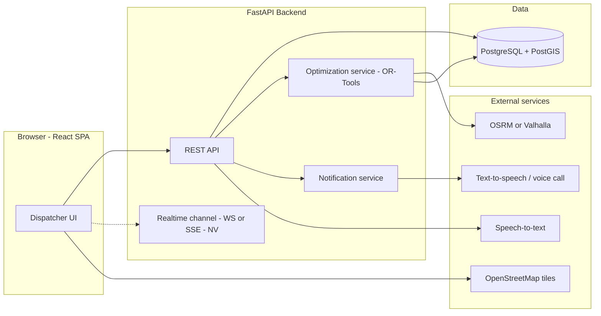

## A.8 Core Invariants (must never be violated)

| ID | Invariant |
|---|---|
| INV-01 | Completed deliveries/stops are immutable under replanning. Historical records never disappear. |
| INV-02 | No proposal marked valid if any vehicle weight or volume capacity is exceeded. |
| INV-03 | No assignment presented as on-time if it violates a delivery window; violations are labeled at-risk/late with cause. |
| INV-04 | Approval binds to one exact `proposalVersion` and its data snapshot. |
| INV-05 | Application requires a server-confirmed approval of the same version and a still-current data snapshot. |
| INV-06 | A stale or superseded proposal can never be applied. |
| INV-07 | UI never optimistically shows approved/applied, completed deliveries, changed assignments, or delivered notifications. |
| INV-08 | Non-idempotent mutations are never auto-retried without idempotency keys or reconciliation. |
| INV-09 | Incident, optimization job, approval, application, and notification lifecycles are separate state machines. |
| INV-10 | Every unassigned order carries an explicit reason. |
| INV-11 | Credentials never appear in URLs, logs, analytics, or user-visible errors. |

---

# B. Sitemap and Route Topology

**Rendering assumption:** All authenticated routes are **Client-rendered** (React SPA; data fetched after mount). Maps, real-time state, and per-user data make SSR/SSG low-value there. `/` and `/login` could be **SSG** only if the build tool supports it — NV; default **Client-rendered**. Do not label any route SSR unless the verified framework (e.g., Next.js) actually server-renders it.

## B.1 URL Tree

```
/                                         → public landing / redirect
/login
/onboarding                               (first-time users; Proposed)
/access-denied
/app                                      → redirect /app/dashboard
├─ /app/dashboard
├─ /app/fleet
│   └─ /app/fleet/vehicles/:vehicleId
├─ /app/plans
│   └─ /app/plans/:planId
│       └─ /app/plans/:planId/routes/:routeId
├─ /app/incidents
│   ├─ /app/incidents/new
│   └─ /app/incidents/:incidentId
│       └─ /app/incidents/:incidentId/proposals/:proposalId   (review & approval)
├─ /app/communications                      (driver/customer notification status)
├─ /app/settings
├─ /app/profile
└─ /app/admin/users                         (Proposed; admin only)
*                                         → not-found
```

## B.2 Common Route Attributes

Unless overridden: Layout = Application Shell (§C); Rendering = Client-rendered; Unauthenticated → redirect to `/login?returnTo=<encoded path+query>` (path must be same-origin, validated; never include tokens); Refresh → re-run session restoration then refetch route data; Direct link → same as refresh; Access denied → `/access-denied` with attempted route ID (not sensitive data).

## B.3 Route Table

| Route ID | URL pattern | Screen / purpose | Parent | Auth | Authorization | Layout | Rendering | Entry | Exits | Params | Query | Data deps | Unsaved changes |
|---|---|---|---|---|---|---|---|---|---|---|---|---|---|
| R-01 | `/` | Landing/redirect | — | Public | — | Public shell | Client (SSG NV) | Typing URL | R-02; R-04 if session valid | — | — | Session check | n/a |
| R-02 | `/login` | Sign-in | — | Public (redirect away if authenticated) | — | Public shell | Client | R-01, any protected route w/o session, session expiry | R-03 or `returnTo`; R-04 | — | `returnTo`, `reason=expired\|loggedout` | Auth endpoint | Guard only if credentials typed + submit pending |
| R-03 | `/onboarding` | First-time setup (Proposed; NV; Q-14) | — | Authenticated | Any | Minimal shell | Client | First login flag | R-04 | — | `step` | Profile/org setup | Warn on leave if step data entered |
| R-04 | `/app/dashboard` | Fleet ops overview, active incidents, KPIs | `/app` | Authenticated | `fleet:read` | App shell | Client | Post-login; nav | R-06, R-08, R-11, R-12 | — | `date`, `status`, `region` (NV) | Plans, vehicles, active incidents | n/a |
| R-05 | `/app` | Redirect | — | Authenticated | — | — | Client | — | R-04 | — | — | — | n/a |
| R-06 | `/app/fleet` | Vehicle list/map, search, sort | `/app` | Authenticated | `fleet:read` | App shell | Client | Nav | R-07 | — | `q`, `sort`, `dir`, `status`, `page` | Vehicles, availability | n/a |
| R-07 | `/app/fleet/vehicles/:vehicleId` | Vehicle detail, capacity, current route | R-06 | Authenticated | `fleet:read` | App shell | Client | R-06, R-09, links | R-06, R-10, R-12 | `vehicleId` | `tab` | Vehicle, assigned route | n/a |
| R-08 | `/app/plans` | Delivery plans list by date | `/app` | Authenticated | `plan:read` | App shell | Client | Nav | R-09 | — | `date`, `status`, `page` | Plans | n/a |
| R-09 | `/app/plans/:planId` | Plan overview: routes, stops, status, map | R-08 | Authenticated | `plan:read` | App shell | Client | R-08, dashboard | R-10, R-07, R-12 | `planId` | `routeId`, `stopId`, `view=map\|list` | Plan, routes, stops, applied version | n/a |
| R-10 | `/app/plans/:planId/routes/:routeId` | Route detail w/ stops (completed/active/pending) | R-09 | Authenticated | `plan:read` | App shell | Client | R-09, R-07 | R-09, R-07 | `planId`,`routeId` | `stopId` | Route, stops, completion events | n/a |
| R-11 | `/app/incidents` | Incident list and filters | `/app` | Authenticated | `fleet:read` | App shell | Client | Nav, alerts | R-12, R-13 | — | `status`, `type`, `severity`, `q`, `page` | Incidents | n/a |
| R-12 | `/app/incidents/new` | Report incident (form + voice) | R-11 | Authenticated | `incident:create` | App shell | Client | Dashboard CTA, vehicle/route actions (prefilled via query) | R-13 | — | `vehicleId`, `routeId`, `type` | Vehicles, plans | **Yes** — dirty form guard |
| R-13 | `/app/incidents/:incidentId` | Incident detail, affected deliveries, lifecycle, start replan | R-11 | Authenticated | `fleet:read` (actions need extra perms) | App shell | Client | R-11, R-12, alerts | R-14, R-09, R-15 | `incidentId` | `tab=overview\|affected\|jobs\|history` | Incident, affected orders/stops, jobs | Guard only for editable metadata edits |
| R-14 | `/app/incidents/:incidentId/proposals/:proposalId` | Proposal review: diff, impact, unassigned, approve/reject/apply | R-13 | Authenticated | `proposal:approve`/`plan:apply` for actions; view `plan:read` | App shell | Client | R-13, alert | R-13, R-09, R-15 | `incidentId`,`proposalId` | `compare=before\|after\|split`, `focus=vehicleId`, `unassigned=1` | Proposal, snapshot validity, diff | Guard if rejection reason typed |
| R-15 | `/app/communications` | Driver/customer notification status & retries | `/app` | Authenticated | `fleet:read` | App shell | Client | Nav, R-13, R-14 | R-13, R-14 | — | `incidentId`, `channel=driver\|customer`, `status` | Notification jobs | n/a |
| R-16 | `/app/settings` | Preferences/integration settings (scope NV) | `/app` | Authenticated | `settings:manage` | App shell | Client | Nav | R-04 | — | `section` | Settings | **Yes** — dirty form |
| R-17 | `/app/profile` | User profile | `/app` | Authenticated | Any | App shell | Client | Header menu | R-04 | — | — | User | Dirty form |
| R-18 | `/app/admin/users` | User/role admin (Proposed; NV; Q-14) | `/app` | Authenticated | `admin:users` | App shell | Client | Nav (admin only) | R-04 | — | `q`,`page` | Users | Dirty form |
| R-19 | `/access-denied` | 403 screen | — | Authenticated | — | App shell (or minimal) | Client | Guard redirect | R-04, back | — | `from` (route ID) | — | n/a |
| R-20 | `*` | Not found | — | Either | — | Context-sensitive shell | Client | Bad URL | R-04 or R-01 | — | — | — | n/a |

## B.4 Route Behavior Rules

| Topic | Rule |
|---|---|
| **Index routes** | `/app` → `/app/dashboard` via replace redirect (no history entry). |
| **Return URL** | `returnTo` accepted only if it starts with `/app` and is same-origin; otherwise default to `/app/dashboard`. Query params preserved. |
| **Authenticated visits /login** | Replace-redirect to `returnTo` or dashboard. |
| **Invalid dynamic id** | Server 404 → in-shell "Not found" panel with link back to parent list (not full R-20). Malformed id (format fails) → R-20. |
| **403 on resource** | In-shell access-denied panel; do not leak resource existence beyond the 403/404 policy chosen by backend (Q-08). |
| **Browser back/forward** | Filters/tabs/selection stored in query params use `replace` for transient changes (typing search) and `push` for meaningful view changes (tab, entity open). Overlays do **not** create history entries unless deep-linkable (R-14 is a route, not an overlay). |
| **Refresh at R-14** | Refetch proposal; if proposal was superseded → show "Superseded" state with link to latest proposal (see §D3/D4). Never show approve controls until validity check completes. |
| **Refresh during optimization** | Refetch incident + active job by incident ID; resume progress display from authoritative job status. |
| **Deep link to completed/applied incident** | Read-only view; actions hidden/disabled with reason. |
| **Unsaved changes** | Guard on R-12, R-16, R-17, R-18, and rejection-reason entry in R-14. In-app navigation → unsaved-changes dialog (OV-14); tab close → native `beforeunload`. |
| **Navigation during active optimization** | Allowed. Job continues server-side. Persistent job indicator in shell (§C); result surfaced via banner/toast linking to R-14. |

---

# C. Global Application Shell and Navigation

## C.1 Shell Components

| Component | Behavior |
|---|---|
| **Sidebar (≥ 1024px)** | Items: Dashboard, Fleet, Plans, Incidents, Communications, Settings; Admin visible only with `admin:users`. Collapsible; collapsed state persisted per user (local). Active item uses `aria-current="page"` plus non-color indicator (bar + bold). |
| **Mobile (< 768px)** | Sidebar becomes a drawer opened from a labeled menu button; bottom tab bar optional (Proposed). Drawer closes on route change; focus returns to menu button. |
| **Header** | Product mark, global search (Proposed), incident alert bell with badge (count + text, not color only), active-job indicator, account menu (Profile, Logout). |
| **Breadcrumbs** | Derived from route hierarchy: Incidents › INC-123 › Proposal v3. Entity labels fetched; skeleton while loading; last crumb is not a link. |
| **Fleet-wide alerts** | Realtime (WS/SSE NV) or polling fallback every 15 s (Proposed). New confirmed incident → banner (non-modal) + bell badge; critical severity uses `role="alert"`. |
| **Active-job indicator** | Shows count of running jobs; click opens popover (OV-05b) listing jobs with status and links. |
| **Connectivity banner** | Persistent top banner when offline or realtime disconnected (OV-17). |
| **Screen toolbars** | Per-screen actions (filters, create, compare toggle). Mutating actions follow §H. |

## C.2 Navigation Matrix (valid outgoing destinations)

| From ↓ / To → | Dash | Fleet | Vehicle | Plans | Plan | Route | Incidents | New Inc | Incident | Proposal | Comms | Settings |
|---|---|---|---|---|---|---|---|---|---|---|---|---|
| **Dashboard** | — | ✓ | ✓ | ✓ | ✓ | | ✓ | ✓ | ✓ | ✓ (via alert) | ✓ | ✓ |
| **Fleet** | ✓ | — | ✓ | ✓ | | | ✓ | ✓ (prefilled) | | | | ✓ |
| **Vehicle** | ✓ | ✓ | — | | ✓ | ✓ | ✓ | ✓ (prefilled) | ✓ | | | |
| **Plans** | ✓ | | | — | ✓ | | ✓ | | | | | |
| **Plan** | ✓ | | ✓ | ✓ | — | ✓ | ✓ | ✓ (prefilled) | ✓ | | | |
| **Route** | ✓ | | ✓ | | ✓ | — | | ✓ (prefilled) | ✓ | | | |
| **Incidents** | ✓ | | | | | | — | ✓ | ✓ | | ✓ | |
| **New Incident** | ✓ (guarded) | | | | | | ✓ (guarded) | — | ✓ (after submit) | | | |
| **Incident** | ✓ | | | | ✓ | | ✓ | | — | ✓ | ✓ | |
| **Proposal** | ✓ | | | | ✓ | | ✓ | | ✓ | — | ✓ | |
| **Communications** | ✓ | | | | | | ✓ | | ✓ | ✓ | — | |
| **Settings** | ✓ (guarded) | ✓ | | ✓ | | | ✓ | | | | | — |

Global header/sidebar destinations are always available from any authenticated screen (subject to guards).

## C.3 State Retention Across Navigation

| State | Retained across navigation? | Mechanism (library-neutral) |
|---|---|---|
| Server data caches (vehicles, plans, incidents) | Yes, with staleness windows (§G) | Query cache |
| List filters/sort/page | Yes, via URL query; last-used restored when returning from detail via `returnTo`/history | URL |
| Map viewport and layer toggles | Per-screen, retained 30 min in session storage (Proposed) | Local UI store |
| Selected vehicle/route/stop | URL param/query first; fallback to store | URL |
| Active job tracking | Global (shell-level) | Shared store + server truth |
| Unsaved drafts | Retained for R-12 as an incident draft (localStorage, no sensitive audio) with restore prompt | Local persistence |
| Overlay state | Closed on navigation unless overlay is blocking-critical (session-expired) | Overlay manager |

## C.4 Keyboard and Focus

- Skip link "Skip to main content" first in tab order.
- On route change: move focus to the page `<h1>` (tabindex -1) and update `document.title`; announce via polite live region "Navigated to {screen}".
- Sidebar: arrow-key roving optional; Tab order must remain logical.
- Global shortcuts (Proposed; must be disableable): `g d` dashboard, `g i` incidents, `/` focus search, `?` shortcut help. Never bind single keys to mutating actions.

## C.5 Navigation During Special States

| Situation | Behavior |
|---|---|
| Active optimization | Free navigation; job indicator persists; completion notification links to R-14. |
| Pending approve/apply request | Navigation **blocked softly**: show warning "An approval is in progress" with options Stay / Leave (request continues server-side; on return, state reconciled). |
| Dirty form | Unsaved-changes dialog (OV-14). |
| Session expired | Blocking prompt (OV-15); navigation disabled until re-auth. |

---

# D. Mermaid Flowcharts

> All 11 Mermaid blocks in this document were rendered successfully with `mermaid-cli` (`mmdc`) at authoring time (syntax validity only — not a review of semantic correctness against the real backend). Re-run in CI after edits (§P-14).

## D1. Authentication and Onboarding

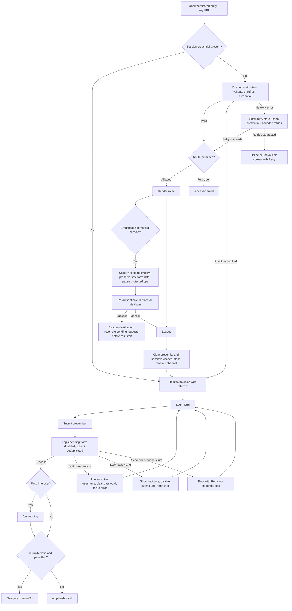

## D2. Primary Operational Workflow

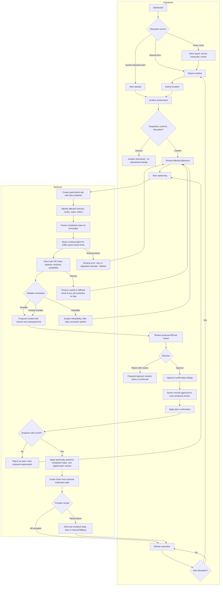

Branch rules:
- **Rejection** returns the incident to `confirmed`; the proposal is terminal (`rejected`). Rejection reason is stored.
- **Infeasibility**: UI shows which constraint blocks (capacity, window, availability, closed road), and options (add vehicle, relax window with explicit consent, defer order). Relaxing any constraint creates a **new** job.
- **Stale data**: any material change in affected vehicles/orders/plan between job start and apply → stale; approval is voided for that version.
- **Subsequent disruption**: handled by §J.5 serialization rules.

## D3. Incident Lifecycle State Machine

Candidate statuses — **must be reconciled with backend enums (NV)**. Approval/application are properties of proposals (D4b), not incident statuses; the incident status mirrors the outcome.

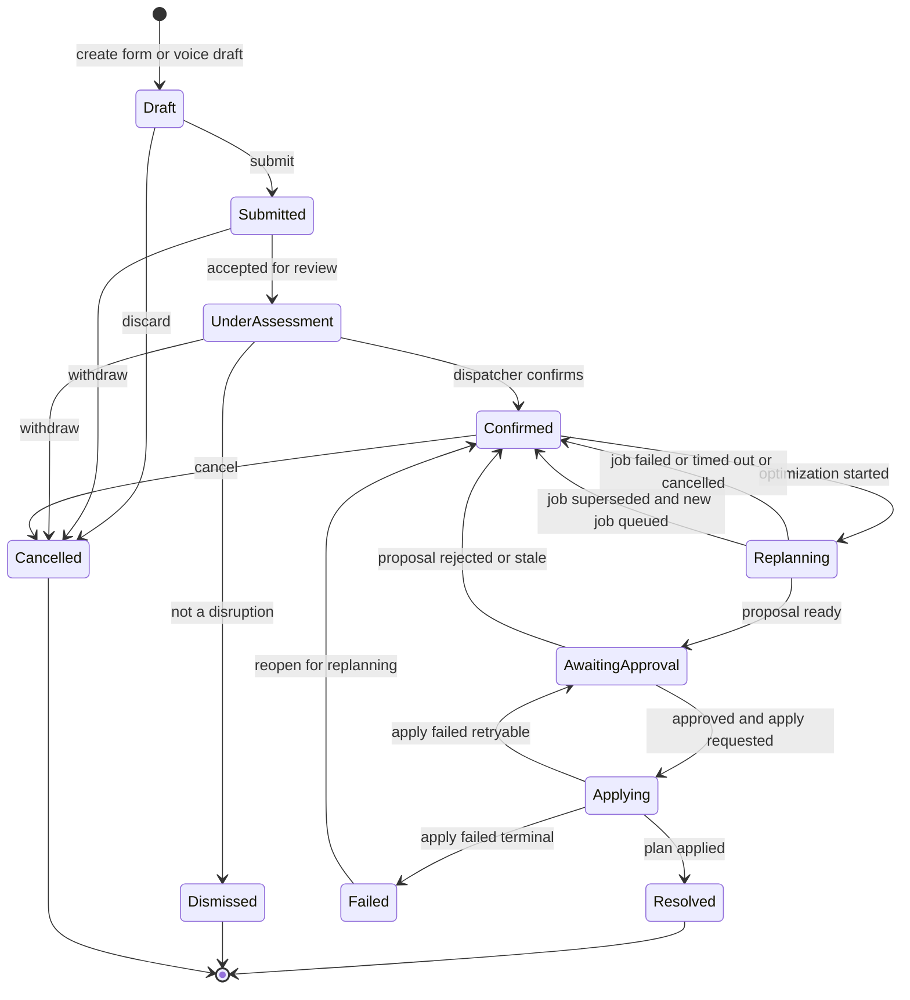

| Transition | Guard | Invalid examples (must be refused, HTTP 409) |
|---|---|---|
| Draft→Submitted | Required fields valid; idempotency key present | Submit twice |
| UnderAssessment→Confirmed | `incident:confirm` | Confirm a Dismissed incident |
| Confirmed→Replanning | `optimization:start`; no other active job for overlapping scope (or merge rule) | Start on Resolved/Cancelled |
| Replanning→AwaitingApproval | Job completed with proposal | From Failed job |
| AwaitingApproval→Applying | Server-confirmed approval for current proposal version; snapshot current | Apply unapproved/stale proposal |
| Applying→Resolved | Atomic apply success | — |
| Any→Cancelled | Only pre-Applying states; `incident:cancel`; **Applying cannot be cancelled by UI** | Cancel Resolved |

`Resolved` means the plan was applied — **not** that notifications were delivered or that all deliveries are complete.

## D4. Optimization Job State Machine

Separate from the incident lifecycle (INV-09).

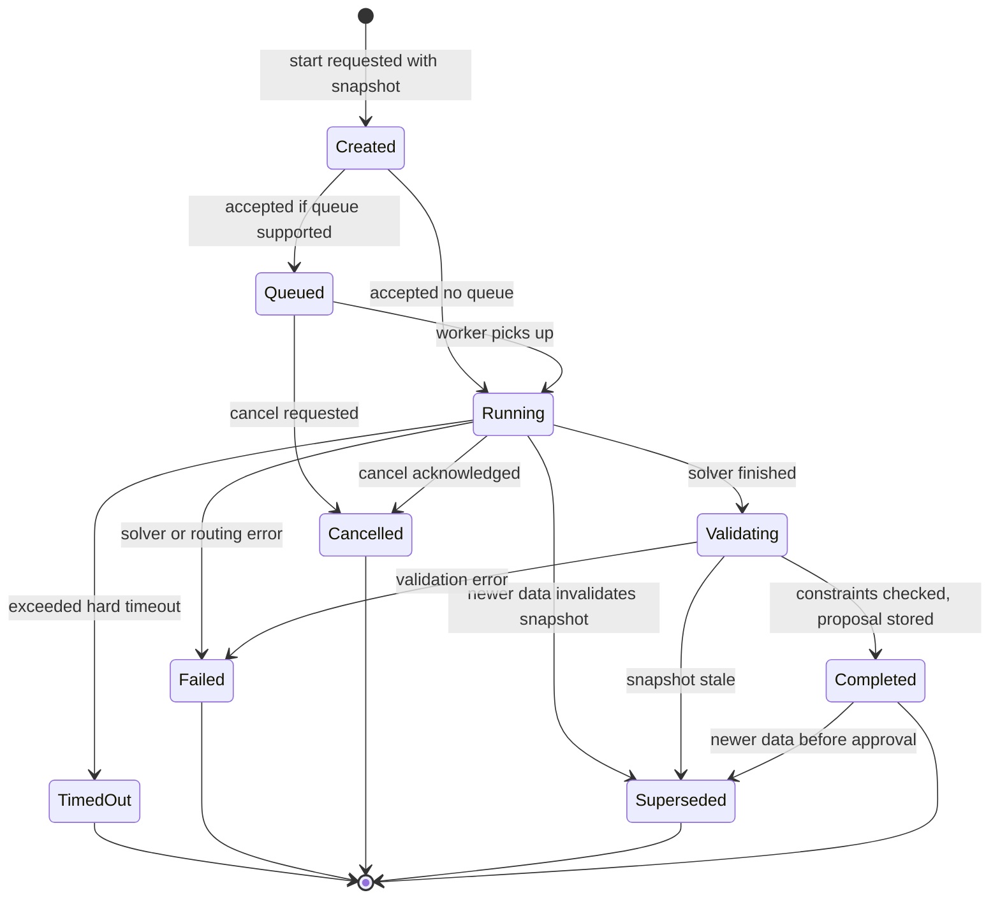

Proposal approval and application are **not** job states in the strict sense. The brief lists "Awaiting approval / Applying / Applied" in the job model; this doc places them on the **proposal/application** machine (D4b) so a completed job can be reasoned about independently. Reconcile with backend (Q-03).

| Topic | Rule |
|---|---|
| Terminal states | Completed, Failed, TimedOut, Cancelled, Superseded |
| Cancellation semantics | Request is *asynchronous*. UI shows "Cancelling…" until server reports Cancelled or a terminal state. If job completes first, show the completed result; do not claim cancellation. |
| Retry | New job with new idempotency key; old job remains in history. Retry allowed from Failed/TimedOut/Cancelled/Superseded. |
| Timeout | Soft threshold (target 2 s, see §J.7) shows "Still working…"; hard timeout is configurable (Q-05). On hard timeout, UI offers Retry, Relax scope, or Manual planning. |
| Superseded | Result retained read-only for audit; never actionable. |

## D4b. Proposal, Approval, Application, and Notification State Machines

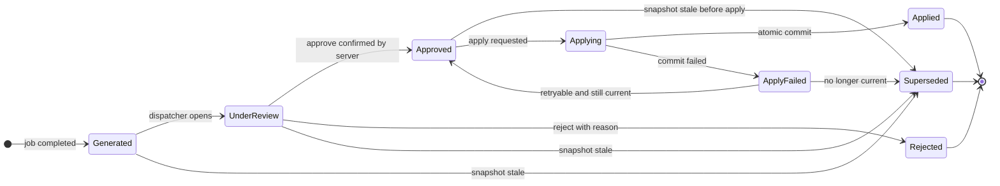

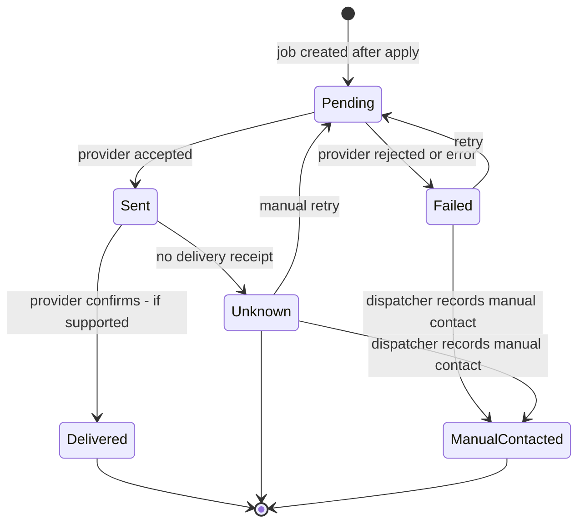

"Delivered" and "Unknown" exist only where the provider semantics support them (NV). Voice calls: answered / voicemail / no-answer states are provider-dependent.

## D4c. Per-Edge Guards and Invalid Transitions (D4, D4b, notification machine)

All guards are **Proposed** and enforced **server-side**; the client only mirrors them by disabling controls. Any transition not listed is invalid and returns HTTP 409 (`invalid_transition`). Terminal states accept no outgoing edge except where listed.

### Optimization job (D4)

| Edge | Guard | Notes / invalid examples |
|---|---|---|
| `[*]`→`created` | `optimization:start`; incident is `confirmed`; scope non-empty; valid `opKey`; snapshot captured | Start on `dismissed`/`cancelled`/`resolved` incident → 409. Empty scope → 422 |
| `created`→`queued` | Queue supported and worker capacity unavailable | — |
| `created`→`running` | Worker available | — |
| `queued`→`running` | Worker picks up and snapshot still current | If snapshot already stale → `superseded` instead |
| `queued`→`cancelled` | Cancel requested by `optimization:start` holder or supervisor | — |
| `running`→`validating` | Solver returned | — |
| `running`→`timed_out` | Hard timeout elapsed | Terminal |
| `running`→`failed` | Solver or routing error | Cause recorded (`routing_unavailable`, `solver_error`, …) |
| `running`→`cancelled` | Cancel acknowledged by worker before `validating` | After `validating` starts, cancel returns the completed outcome instead |
| `running`→`superseded` | Newer versioned data in scope (§J.5) | Terminal; result discarded |
| `validating`→`completed` | All hard constraints pass (capacity, availability, frozen stops); proposal stored with `proposalVersion` | Never reached with a capacity violation (INV-02) |
| `validating`→`failed` | Validation error | — |
| `validating`→`superseded` | Snapshot stale at validation | — |
| `completed`→`superseded` | Newer versioned data in scope before apply | The only edge out of `completed` |
| Invalid | Any edge out of `timed_out`, `failed`, `cancelled`, `superseded`; `completed`→`running`; any edge into `created` | 409 |

### Proposal / approval / application (D4b)

| Edge | Guard | Notes / invalid examples |
|---|---|---|
| `[*]`→`generated` | Job `completed` | — |
| `generated`→`under_review` | A user with `plan:read` opens R-14 and the server records review start (idempotent) | Approve before `under_review` → 409 (Q-17) |
| `under_review`→`approved` | `proposal:approve`; request `proposalVersion` equals current; snapshot current; completed-stops-unchanged flag true; approver identity recorded | Stale → 409 `plan_stale`; wrong version → 409 `proposal_superseded` |
| `under_review`→`rejected` | `proposal:reject`; non-empty reason | Terminal |
| `generated`/`under_review`/`approved`→`superseded` | Snapshot became stale | Voids any approval (INV-04, INV-06) |
| `approved`→`applying` | `plan:apply`; approval exists for this exact version; snapshot current; no other apply in progress for the plan | Apply on `generated`/`under_review`/`rejected`/`superseded` → 409 |
| `applying`→`applied` | Atomic commit succeeded; new `planVersion` recorded; completed stops unchanged | Terminal |
| `applying`→`apply_failed` | Commit failed or rolled back (nothing partially applied) | — |
| `apply_failed`→`approved` | Failure was retryable and snapshot still current | Dispatcher may apply again (new intent, new `opKey`) |
| `apply_failed`→`superseded` | Snapshot no longer current | — |
| Invalid | `applied`/`rejected`/`superseded` → anything; `approved`→`under_review`; `approved`→`rejected` (Proposed: approvals are not withdrawn, only superseded; Q-02) | 409 |

### Notification job

| Edge | Guard | Notes |
|---|---|---|
| `[*]`→`pending` | Created by successful apply only (never before) | — |
| `pending`→`sent` | Provider accepted the request | — |
| `pending`→`failed` | Provider rejected or error | Attempt count incremented |
| `sent`→`delivered` | Provider receipt received (only where supported) | — |
| `sent`→`unknown` | No receipt within window | Where receipts are unsupported, `sent` may time out to `unknown` |
| `failed`→`pending` | `notification:retry`; attempt count below maximum (Proposed 3; Q-18) | At maximum → only `manual_contacted` is offered |
| `unknown`→`pending` | `notification:retry`; manual confirmation | — |
| `failed`/`unknown`→`manual_contacted` | `notification:retry`; non-empty note; actor and time recorded | Terminal; auditable |
| Invalid | `delivered`/`manual_contacted` → anything; `pending`→`delivered` directly | 409 |

## D5. Exception and Network Recovery

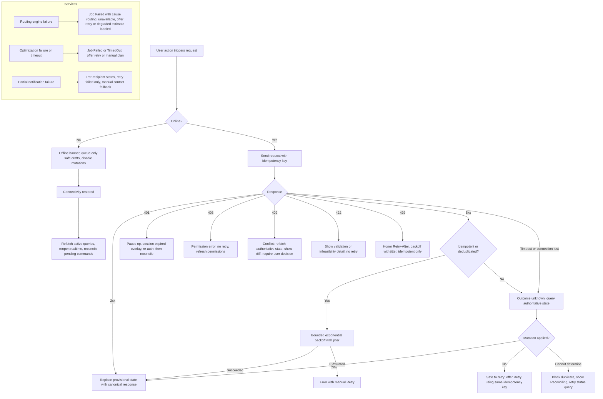

Additional cases:

| Case | Behavior |
|---|---|
| Realtime disconnect | Banner "Live updates paused". Auto-reconnect with backoff + jitter, cap 30 s. On reconnect: refetch active entities (incidents, jobs, plans, proposals), then resume stream from last event cursor if supported (NV). Polling fallback every 15 s while disconnected. |
| Duplicate submission | Button disabled while pending; idempotency key reused for retries of the *same* user intent; new intent → new key. Server returns existing resource for repeated key. |
| Stale optimization result | Server rejects apply with 409 `plan_stale` (Proposed code); UI shows reason and link to regenerate. |
| Refresh during pending op | On load, query for in-flight jobs/commands tied to the incident; show actual status. Never assume failure. |

## D6. State Synchronization

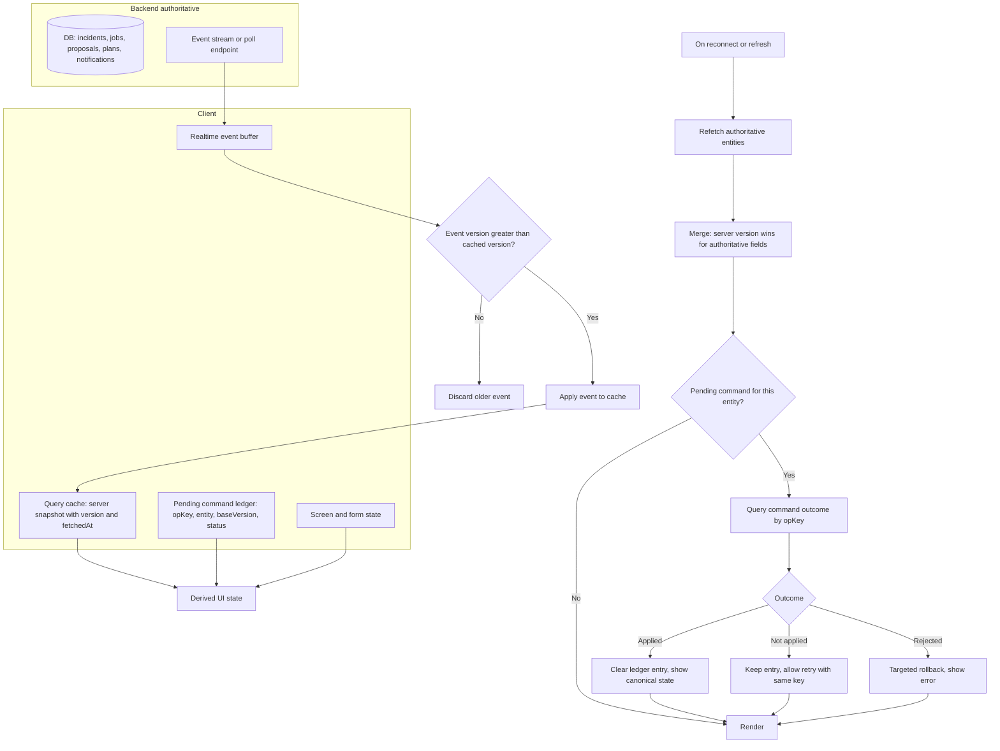

Merge rule: compare per-entity `version`/`updatedAt` (field names NV). Local unsent form edits are never overwritten by server data; instead show "Updated elsewhere" with diff on conflict.

---

# E. Screen-by-Screen Interaction Matrix

**How the ten required per-interaction attributes map to the six columns:**

| Required attribute | Where it appears |
|---|---|
| 1 Trigger element | *Trigger Element* |
| 2 User intent; 4 Backend request? | *Event Action* (intent first; "REST" or "local" states whether a request occurs) |
| 3 Transition / destination | *Target State / Destination* |
| 5 Pending UI; 6 Duplicate-click prevention | *Loading / Pending State* |
| 7 Success behavior | *Target State / Destination* |
| 8 Failure; 9 Rollback / reconciliation; 10 Accessibility | *Error Handling / Rollback* |

Endpoint paths are intentionally omitted (not verified). "REST" means a call to the corresponding FastAPI resource (NV). All mutations carry an idempotency key (Proposed; backend support NV).

## E.1 Global, Auth, and Shell

| Source Screen | Trigger Element | Event Action | Target State / Destination | Loading / Pending State | Error Handling / Rollback |
|---|---|---|---|---|---|
| Any (public) | Protected URL typed w/o session | Intent: open page. Local guard check, then session restoration (REST) | Valid → requested route; invalid → `/login?returnTo=…` | Full-screen splash with `aria-busy`; max 5 s then retry UI | Network error: Retry view, credential kept. 401: login redirect |
| `/login` | "Sign in" button / Enter in field | Intent: authenticate. REST login | Success → onboarding (first-time) or `returnTo`/dashboard | Button disabled + spinner + "Signing in" live region; Enter ignored while pending | 401 invalid: inline error, password cleared, focus to error summary. 429: show wait time. 5xx/network: Retry; no field loss |
| `/login` | Field validation on blur | Local validation | Inline messages | None | Errors tied via `aria-describedby` |
| `/onboarding` | "Continue"/"Finish" (NV) | Save step (REST) | Next step or dashboard | Disabled + spinner | Validation inline; failure keeps step data locally; leave-guard if dirty |
| App shell | Sidebar link | Intent: navigate. Local route change | Target route | Route skeleton; prior content stays until data ready (avoid blank flash) | Guard prompts if dirty (OV-14); focus to new `<h1>` |
| App shell | Breadcrumb link | Navigate to ancestor | Ancestor route (preserve list query when possible) | Skeleton | Same guards |
| App shell | Account menu → Logout | Intent: end session. REST logout, then local cleanup | `/login?reason=loggedout` | Menu item disabled "Logging out" | If REST fails: still clear local credential/caches, close realtime; warn if server session may persist |
| App shell | Alert bell | Open alert popover (local) | Popover listing active incidents | Skeleton if loading | Item click navigates to R-13; "Preview" on an item whose proposal is ready opens OV-07 (read-only summary, **no approve**); Esc closes, focus returns to bell |
| App shell | Active-job indicator | Open jobs popover (OV-05b) | List w/ status | Live status | Job link → R-13/R-14 |
| App shell | Mobile menu button | Toggle drawer (local) | Drawer open/closed | None | Esc closes; focus trap while open; focus returns to button |
| App shell | Offline banner "Retry now" | Force connectivity probe + refetch | Banner clears on success | Button spinner | Remains with timestamp of last attempt |
| App shell | Session-expired overlay "Sign in again" | Re-authenticate (REST) | Overlay closes; destination restored; pending commands reconciled | Disabled + spinner | Fail: stay in overlay; "Sign out" alternative preserves local safe drafts per §I |
| Any | Browser back/forward | Router history | Prior route/query | Cached data shown with refresh | Guard on dirty forms; back from R-14 never re-triggers mutations |

## E.2 Dashboard (R-04)

| Source Screen | Trigger Element | Event Action | Target State / Destination | Loading / Pending State | Error Handling / Rollback |
|---|---|---|---|---|---|
| Dashboard | Date selector | Intent: view another day. Update `date` query; REST refetch | Same route, new data | Skeleton on affected widgets; previous data dimmed `aria-busy` | Failure: widget-level error + Retry; keep previous date data labeled stale |
| Dashboard | Status/region filter | Update query; refetch | Filtered widgets | Debounced 250 ms; spinner on widget | Same as above; invalid query value ignored and normalized |
| Dashboard | Manual refresh | Refetch (REST) | Updated data + "Updated hh:mm" | Icon spinner; button disabled | Toast warning if failed; keep data |
| Dashboard | Incident alert card | Navigate | R-13 | Skeleton | 404 → in-shell not found |
| Dashboard | "Report incident" CTA | Navigate to R-12 | R-12 | Skeleton | Requires `incident:create`, else CTA hidden |
| Dashboard | "Quick report" (Proposed) | Opens OV-01 drawer; submit → REST create/submit w/ idempotency key | Incident `submitted`; drawer closes; link to R-13 | Drawer controls disabled + spinner | Same failure rules as R-12 submit (E.5); dirty close → OV-14; "Open full form" carries entered data to R-12 |
| Dashboard | Vehicle tile | Navigate | R-07 | Skeleton | 403/404 in-shell |
| Dashboard | Map marker/cluster | Select (local) → detail card | Selection card; "Open" link | None | Keyboard-reachable list equivalent exists (§K) |
| Dashboard | Realtime update arrives | Merge event into cache (local) | Widgets update; polite live announcement for critical incidents only | None | Older/duplicate events dropped by version |

## E.3 Fleet and Vehicle (R-06, R-07)

| Source Screen | Trigger Element | Event Action | Target State / Destination | Loading / Pending State | Error Handling / Rollback |
|---|---|---|---|---|---|
| Fleet | Search box | Update `q` (replace history); REST refetch | Filtered list | Debounce 300 ms; row skeleton; results count live region | Failure: inline error + Retry; keep prior results labeled stale |
| Fleet | Column header sort | Update `sort`,`dir` | Re-sorted list | Skeleton or instant if client-sorted | `aria-sort` updated |
| Fleet | Status filter | Update `status` | Filtered | As search | Invalid value normalized |
| Fleet | Pagination controls (NV) | Update `page` | Page N | Skeleton rows | Out-of-range page → last page |
| Fleet | Vehicle row | Navigate / select | R-07 (or highlight on map) | Skeleton | 404 → in-shell not found |
| Fleet | "Report breakdown" row action | Navigate to R-12 with `vehicleId`,`type=breakdown` | R-12 prefilled | Skeleton | Vehicle unavailable/already has open breakdown → warning with link to existing incident |
| Vehicle detail | Tab (Overview/Route/History) | Update `tab` | Tab panel | Panel skeleton | Roving tabindex, `aria-selected` |
| Vehicle detail | "View route" | Navigate | R-10 | Skeleton | No route today → empty state |

## E.4 Plans and Routes (R-08, R-09, R-10)

| Source Screen | Trigger Element | Event Action | Target State / Destination | Loading / Pending State | Error Handling / Rollback |
|---|---|---|---|---|---|
| Plans | Date/status filter | Update query; refetch | Filtered plans | Skeleton | Retry inline |
| Plans | Plan row | Navigate | R-09 | Skeleton | 404 in-shell |
| Plan | Map/list toggle (`view`) | Local + query | View switch | None | Preference remembered |
| Plan | Route row or polyline click | Select route (`routeId`) | Highlight + side panel | None | Keyboard: list is primary; map is enhancement |
| Plan | Stop marker/row click | Select stop (`stopId`) | Stop detail panel with status, window, order(s) | None | Completed stops show lock indicator + "Completed hh:mm"; no edit controls |
| Plan | Layer toggles (completed/active/proposed/unassigned) | Local | Visibility only | None | Status never conveyed by color alone (icon + label) |
| Plan | Map pan/zoom/fit | Local | Viewport | Tile spinner | Tile failure → banner "Map unavailable", list remains fully usable |
| Plan | "Report incident" on route/stop | Navigate to R-12 prefilled | R-12 | Skeleton | — |
| Route | Stop reorder controls (**not supported**) | — | — | — | Direct manual edits are out of scope; replanning only via incident flow (Q-09) |

## E.5 Incident Reporting (R-12) — Form and Voice

| Source Screen | Trigger Element | Event Action | Target State / Destination | Loading / Pending State | Error Handling / Rollback |
|---|---|---|---|---|---|
| New Incident | Type selector (breakdown/closure/urgent/traffic/other) | Local; reveals type-specific fields | Form variant | None | Changing type with entered data → confirm clearing type-specific fields |
| New Incident | Vehicle/route/stop pickers | Local + REST for options | Selected entities | Option list skeleton | Unavailable entity disabled with reason |
| New Incident | Location input / map pin (closure) | Local; geocode REST (NV) | Coordinates set | Spinner | Geocode fail → manual lat/long or map click |
| New Incident | Severity selector | Local | Severity set | None | Required; default none |
| New Incident | Free-text description | Local; autosave draft locally (debounced) | Draft stored | None | Storage failure → silent, warn on leave |
| New Incident | "Save draft" | REST create/update draft | Draft saved; "Saved hh:mm" | Disabled+spinner | Failure: keep local, toast error (no data loss) |
| New Incident | "Submit incident" | Intent: report. Validate locally → REST submit w/ idempotency key | Success → R-13 (`submitted`) | Button disabled + spinner; form read-only; duplicate Enter ignored | 422: field errors focused. 409 duplicate open incident for same vehicle/type → show existing incident link, allow "Create anyway" only if backend allows (Q-07). Timeout: query by key before retry. Network: draft preserved |
| New Incident | "Cancel"/leave | Guard | R-11 or origin | — | Dirty → OV-14 |
| New Incident | "Record voice" | Intent: dictate report. If permission unknown → OV-04, else OV-03 | Recording overlay | Permission request pending | Denied → manual-form fallback (see below) |
| Voice overlay | Mic permission "Allow" (browser prompt) | Browser permission | Recording starts | "Waiting for permission" | Denied/blocked: message with browser-settings steps; type instead |
| Voice overlay | Start/Stop recording | Local capture | Recording → stopped | Timer, level meter + text status "Recording 00:12" | Device missing/in use: error + choose device/typing. Max length reached: auto-stop with notice |
| Voice overlay | "Discard recording" | Local | Idle | — | Confirm if > 5 s |
| Voice overlay | "Use recording" | Upload audio + request transcription (REST, NV) | Transcription review (OV-19) | Progress "Transcribing"; Cancel available; upload deduplicated per recording ID | Upload fail: Retry/keep local blob until overlay closed. STT fail/timeout: "Couldn't transcribe" → Retry or type manually; recording retained until user discards |
| Transcription review | Edit transcript text | Local | Edited text | — | Low-confidence segments marked with text cue (NV) |
| Transcription review | "Accept & fill form" | Local mapping into form fields (extraction REST NV) | Form prefilled; **not submitted** | Spinner if extraction | Extraction fail: paste transcript into description only. Transcript ≠ submission (§J.6) |
| Any form | Esc key | Closes overlay only; does not submit | — | — | Dirty overlay content → confirm |

## E.6 Incident List and Detail (R-11, R-13)

| Source Screen | Trigger Element | Event Action | Target State / Destination | Loading / Pending State | Error Handling / Rollback |
|---|---|---|---|---|---|
| Incidents | Filters (status/type/severity), search | Update query; refetch | Filtered | Skeleton; count live region | Retry inline |
| Incidents | Row | Navigate | R-13 | Skeleton | 404 handling |
| Incident | Tabs (overview/affected/jobs/history) | Update `tab` | Panel | Skeleton | — |
| Incident | "Confirm disruption" | Intent: mark as real. Opens OV-02 (shows affected counts); on Confirm → REST transition `under_assessment→confirmed` | Status confirmed; affected deliveries computed | Disabled + spinner; **no optimistic status change** | 409 invalid state: refetch, show current status. 403: hidden/disabled w/ reason |
| Incident | "Dismiss" | REST transition → dismissed (reason required) | Dismissed (terminal) | Disabled + spinner | Same |
| Incident | "Cancel incident" | OV-16 confirm → REST | Cancelled | Spinner in dialog | Not allowed during Applying/Resolved |
| Incident | Edit severity/notes metadata | Local edit → "Save" REST | Updated metadata | Save pending indicator; provisional display allowed (§H) | 409: show server value + user value, choose; guard on dirty |
| Incident | Affected-orders table row/sort/filter | Local + REST (NV) | Row detail | Skeleton | Each row shows status (completed / en route / pending) and why affected |
| Incident | Affected-order row marked Completed | — (read-only) | Excluded from replan scope; lock icon | — | No actions available (INV-01) |
| Incident | "Generate recovery plan" | Intent: replan. REST create optimization job w/ snapshot + idempotency key | Job Created → Running; progress panel (OV-05) | Button disabled; progress with elapsed time; NOT a fake percentage unless backend reports progress | 409 active job exists for overlapping scope → link to it or offer "Supersede". 422 no affected orders → explain. 5xx: Retry same key. Timeout: query for job by key |
| Incident | Progress panel "Cancel optimization" | OV-16 → REST cancel | "Cancelling…" until server terminal state | Disabled + spinner | If completed before cancel: show result. Cancel fail: remain Running |
| Incident | Progress panel "Keep working elsewhere" | Close overlay (job continues) | Overlay closed; indicator in shell | — | Completion alert links to R-14 |
| Incident | Soft-timeout notice (>2 s target) | Auto | "Still working…" (non-failure) | Status text | Hard-timeout → OV-06 |
| Incident | Hard-timeout dialog "Retry" | New job (new key) | Running | Spinner | Repeated failure → "Plan manually" guidance, link to plan |
| Incident | Hard-timeout dialog "Reduce scope"(Proposed) | New job with narrower scope | Running | Spinner | Warn that global feasibility may reduce |
| Incident | "Open latest proposal" | Navigate | R-14 | Skeleton | Superseded → show latest |
| Incident | History tab entries | Local expand | Detail | — | — |

## E.7 Proposal Review and Approval (R-14)

| Source Screen | Trigger Element | Event Action | Target State / Destination | Loading / Pending State | Error Handling / Rollback |
|---|---|---|---|---|---|
| Proposal | Page load | REST fetch proposal + validity check | Review UI; approve controls disabled until validity check returns | Skeleton; `aria-busy` | Superseded/stale banner (blocking) with link to latest; fetch error: Retry |
| Proposal | Compare toggle (before/after/split) | Update `compare` | Map/list view | None | Equivalent text diff always available |
| Proposal | Vehicle filter/`focus` | Local + query | Highlights vehicle changes | None | — |
| Proposal | Route/stop selection | Local | Detail panel: before vs after, ETA vs window, load % | None | Completed stops locked & unchanged (verify "unchanged" assertion: server-provided flag) |
| Proposal | Impact summary (cost, distance, fuel, emissions, on-time) | Display | Deltas with **units and basis** (estimated, not measured) | None | Missing metrics: "Not available", never zero |
| Proposal | Unassigned-order row / "Why?" | Open OV-11 | Explanation w/ constraint(s) | None | No reason from backend → "Reason not provided" error state flagged as defect (INV-10) |
| Proposal | Constraint warnings (at-risk/late) | Display with icon + text | Expandable detail | None | — |
| Proposal | "Approve" | OV-08 confirmation (must show version, counts, unassigned, late counts) | On confirm: REST approve w/ `proposalVersion`+key | Dialog button disabled + spinner; **no optimistic approved state** | 409 stale/superseded → dialog closes, blocking banner. 403 → permission message. Timeout → query approval status before allowing retry. Success → "Approved" banner + "Apply" enabled |
| Proposal | "Reject" | OV-09 (reason required) → REST reject | Proposal rejected; incident → confirmed; offer "Generate new plan" | Spinner in dialog | Reason preserved on failure; unsaved-changes guard |
| Proposal | "Apply plan" (only after server-confirmed approval) | OV-10 confirmation → REST apply w/ approval ID + key | Applying (progress) → Applied | Disabled + spinner; "Applying" live region; navigation soft-blocked | 409 stale → superseded; 422 constraint violated at apply → show; timeout/unknown → "Verifying outcome…" query; never allow second apply until reconciled. Partial failure not allowed: apply is atomic (server contract, NV) |
| Proposal | "Approve & apply" combined (**not recommended**) | — | — | — | Keep as two explicit steps unless product decides otherwise (Q-02) |
| Proposal | Post-apply "View updated plan" | Navigate | R-09 | Skeleton | Shows new applied plan version |
| Proposal | Post-apply "View notifications" | Navigate | R-15 `incidentId` | Skeleton | — |
| Proposal | "Regenerate" (when superseded) | REST new job | R-13 progress | Spinner | As E.6 |

## E.8 Communications (R-15)

| Source Screen | Trigger Element | Event Action | Target State / Destination | Loading / Pending State | Error Handling / Rollback |
|---|---|---|---|---|---|
| Communications | Channel/status filters | Update query; refetch | Filtered list | Skeleton | Retry |
| Communications | Notification row expand | Local | Detail: recipient (masked), attempts, provider status | None | Customer PII masked by default (§L) |
| Communications | "Retry" on failed row | Confirm (OV-12/OV-13 as applicable) → REST retry w/ key | Row → Pending | Row spinner; button disabled | Provider reject: show reason; max attempts reached → manual fallback (copy script/call list). Timeout: query job status first |
| Communications | "Retry all failed" | OV confirmation → REST batch | Batch progress | Spinner; per-row states update | Partial success reported per row; failed rows remain retryable |
| Communications | "Mark contacted manually" (Proposed) | REST | Row → manual_contacted (auditable) | Spinner | Requires note |
| Communications | Driver ack status | Display | Acknowledged/Not acknowledged | — | "Unknown" if channel lacks acks (Q-16) |
| Communications | "Preview message/voice script" | Local/REST | Preview popover; TTS playback optional (NV) | Audio loading | Autoplay never; transcript always shown |

## E.9 Settings, Profile, Admin

| Source Screen | Trigger Element | Event Action | Target State / Destination | Loading / Pending State | Error Handling / Rollback |
|---|---|---|---|---|---|
| Settings/Profile | Form fields | Local | Dirty state | — | Guard on leave |
| Settings/Profile | "Save" | REST update | Saved; toast success | Disabled + spinner; optimistic display allowed for cosmetic prefs | 409 → show server value; 422 inline |
| Settings/Profile | "Discard" | Local reset | Clean | — | Confirm if > N changes |
| Admin users | Role change (Proposed) | OV-18 → REST | Updated role | Spinner | No optimistic update; self-demotion blocked |

---

# F. Modal, Drawer, Popover, and Toast Registry

All overlays are **Proposed** (NV against the existing component library). Overlay IDs are referenced throughout.

## F.1 Overlay Catalog

| Overlay ID | Type | Trigger | Purpose | Required Data | Primary Action | Secondary Action | Dismiss Rules | Escape / Backdrop Rules | Focus Management | Error Behavior |
|---|---|---|---|---|---|---|---|---|---|---|
| OV-01 | Drawer | Dashboard "Quick report" (Proposed) | Fast incident intake without leaving dashboard | Type, vehicle/location, severity | Submit | Open full form (carries data to R-12) | Dirty → OV-14 | Esc = close (with guard); backdrop click ignored when dirty | Trap; initial focus first field; restore to trigger | Inline field errors; failure keeps data |
| OV-02 | Modal | R-13 "Confirm disruption" | Confirm incident is real; show affected counts | Incident, affected summary | Confirm | Cancel | Cancel/Esc | Esc closes; backdrop closes | Initial focus Cancel (safer default); restore to trigger | Error in dialog; stays open |
| OV-03 | Modal | R-12 "Record voice" | Capture audio | Mic permission granted | Stop / Use recording | Discard | Recording active → Esc asks to discard | Esc: if recording, confirm; backdrop disabled | Initial focus Start/Stop; trap; restore | Device errors inline w/ typed-input fallback |
| OV-04 | Modal | Mic permission unknown/denied | Explain why mic is needed, how to enable | Permission state | Continue (triggers browser prompt) | Type instead | Any button/Esc | Esc = Type instead | Initial focus Continue | Denied → instructions + manual path |
| OV-05 | Panel/Modal (non-blocking option) | Optimization started | Show job status, elapsed, scope, cancel | Job ID, status, startedAt | Cancel optimization | Continue elsewhere | Closing never cancels job | Esc = Continue elsewhere; backdrop close ok | Focus on status region; polite live updates (not every second) | Failed/timeout transitions to OV-06 or failure state in-panel |
| OV-05b | Popover | Header job indicator | List running/recent jobs | Active jobs | Open job | Close | Click outside/Esc | Esc closes, focus to trigger | Trap-less popover; arrow nav | Fetch error row w/ Retry |
| OV-06 | Modal | Hard timeout or job Failed | Explain failure/timeout, offer recovery | Job ID, cause, elapsed | Retry | Reduce scope / Plan manually / Close | Close allowed | Esc closes | Initial focus Retry | Retry fails → remains with updated cause |
| OV-07 | Drawer | "Quick preview" of proposal from alerts (Proposed) | Read-only summary; **no approve here** | Proposal summary | Open full review (R-14) | Close | Close | Esc/backdrop close | Trap; restore | Fetch error + Retry |
| OV-08 | Modal | R-14 "Approve" | Confirm approval of exact version | proposalId, version, counts: reassigned, at-risk, late, unassigned; approver identity | Approve | Cancel | Pending: not dismissible by backdrop | Esc closes only when idle | Initial focus Cancel; trap; restore to Approve button | 409 → close + stale banner; 403 → message; unknown outcome → "Verifying…" state |
| OV-09 | Modal | R-14 "Reject" | Reject w/ reason | proposalId, reason text (required), optional category | Reject proposal | Cancel | Dirty reason → confirm discard | Esc closes with guard | Initial focus reason field; restore | Failure retains reason |
| OV-10 | Modal | R-14 "Apply" | Explicit final confirmation of live-plan mutation | approvalId, version, snapshot validity, list of affected vehicles/drivers/customers, notification intent | Apply plan | Cancel | Pending: not dismissible | Esc idle only | Initial focus Cancel | Stale → close + banner; unknown → Reconciling state; no auto-retry |
| OV-11 | Popover/Modal (mobile) | "Why?" on unassigned order | Explain constraint cause(s) | Order, reason code(s), constraint details, suggested actions | Close | Open order / View alternatives | Esc/click-outside | Esc closes | Trap on modal; restore | Missing reason → explicit "Reason unavailable" |
| OV-12 | Modal | Retry/send driver notification | Confirm driver message batch | Recipient driver(s), content summary, channel | Send | Cancel | Cancel/Esc | Esc idle | Initial focus Cancel | Per-recipient results after send; partial failure remains open with summary |
| OV-13 | Modal | Retry/send customer voice notification | Confirm customer notices; note outside-hours rules (NV) | Count, customers (masked), script preview | Send | Cancel | Cancel/Esc | Esc idle | Initial focus Cancel | As OV-12 |
| OV-14 | Modal | Navigation with dirty state | Unsaved-changes warning | Dirty scope description | Stay | Discard and leave (destructive style) | Stay/Esc = Stay | Esc = Stay; backdrop ignored | Initial focus Stay | — |
| OV-15 | Blocking modal | 401 / expired session | Re-authenticate without losing context | None | Sign in again | Sign out | Not dismissible | Esc/backdrop disabled | Initial focus primary; background `inert` | Auth failure inline; 429 wait |
| OV-16 | Modal | Cancel incident/job | Confirm cancellation | Entity, consequences | Cancel it | Keep | Keep/Esc | Esc = Keep | Initial focus Keep | Too late (terminal) → explanatory message |
| OV-17 | Banner (persistent) | Offline or realtime lost | Inform & block mutations | Connectivity state | Retry now | — | Auto-clears on recovery | n/a | Not focus-stealing; `role="status"` | — |
| OV-18 | Modal | Generic destructive action | Confirm irreversible change | Action description | Confirm (destructive) | Cancel | Cancel/Esc | Esc idle | Initial focus Cancel | Inline error |
| OV-19 | Modal | After STT completes | Review/edit transcript | Transcript, confidence (NV) | Accept & fill form | Edit / Re-record / Discard | Discard w/ confirm if edited | Esc → confirm | Focus transcript field; restore | Fail → type manually |

## F.2 Overlay Behavior Standards

| Topic | Standard |
|---|---|
| **Stacking order (low→high)** | Shell < popovers < drawers < modals < confirmation modals opened from modals < toasts < OV-15 session-expired. Max 2 stacked modals; a third replaces. |
| **Scroll lock** | Applied for modals/drawers; compensate scrollbar width; released on close/route change. |
| **Initial focus** | Safest control for destructive/high-impact (Cancel); first invalid/required field for forms. |
| **Focus trap** | Required for modals/drawers; background marked `inert` (not only `aria-hidden`). |
| **Focus restoration** | Return to triggering element; if removed (e.g., row re-rendered), to nearest logical container heading. |
| **Escape** | Closes only when safe: never while a high-impact request is pending; dirty content → OV-14-style guard. |
| **Backdrop click** | Disabled for OV-08, OV-10, OV-15 and any pending/dirty overlay. |
| **Route change while open** | Non-critical overlays close; overlays with pending mutation (OV-08/OV-10) block navigation (soft-block dialog); OV-15 persists across routes. |
| **Browser back** | Closes top overlay only if it was history-bound (none by default); otherwise navigates, subject to guards. |
| **ARIA** | `role="dialog"`/`alertdialog` for destructive; `aria-modal="true"`; labelled and described. |
| **Reduced motion** | No slide/zoom; instant open/close. |
| **Responsive** | Drawers become full-screen sheets < 640 px. |

## F.3 Toast Registry (non-critical feedback only)

**Rule:** Toasts are never the only confirmation for approve or apply; those use persistent in-page banners with timestamp and version.

| Toast ID | Level | Message pattern | Duration | Persist? | Dedupe key | Action | Announcement |
|---|---|---|---|---|---|---|---|
| T-01 | Success | "Draft saved" | 4 s | No | `draft-saved:{id}` | — | `role="status"` polite |
| T-02 | Success | "Incident {id} submitted" | 6 s | No | `incident-submitted:{id}` | View | polite |
| T-03 | Info | "Plan generation started" | 4 s | No | `job-started:{jobId}` | View progress | polite |
| T-04 | Success | "Recovery plan ready for review" | 10 s | Until dismissed if tab hidden | `proposal-ready:{proposalId}` | Review | polite |
| T-05 | Warning | "Plan became outdated" | Persistent | Yes | `stale:{proposalId}` | Regenerate | assertive |
| T-06 | Warning | "Live updates paused" | Persistent (banner OV-17 preferred) | Yes | `rt-down` | Retry | polite |
| T-07 | Error | "Couldn't save changes" | 8 s | No | `save-failed:{entity}` | Retry | assertive |
| T-08 | Warning | "Some notifications failed ({n})" | Persistent | Yes | `notif-fail:{incidentId}` | View | assertive |
| T-09 | Info | "Updated elsewhere: {entity}" | 6 s | No | `ext-update:{entity}:{version}` | Refresh | polite |
| T-10 | Error | "Request timed out — verifying result" | Persistent until resolved | Yes | `unknown:{opKey}` | — | assertive |

Rules: max 3 visible; newest on top; hover/focus pauses timer; dismiss with Esc when focused; no sensitive customer data in toast text; deduplicate by key (increment count instead of stacking); announcements do not steal focus.

---

# G. Frontend State Model and Ownership

> Library-neutral. **State library, data-fetching library, router, and form library are NV.** Common baseline for React+TS (e.g., a server-state cache plus a small client store) is an assumption, not a finding. Replace the "Owner" column with real libraries after verification.

## G.1 State Ownership Matrix

| State | Owner | Persistence | Source of Truth | Invalidation Event | Recovery Strategy |
|---|---|---|---|---|---|
| Session / user / permissions | Auth store | Memory + secure credential storage per existing mechanism (NV) | Backend | 401, logout, permission change event | Restore session; refetch `me`; OV-15 |
| Vehicles | Server cache | Memory (staleTime ~15–30 s Proposed) | Backend | Realtime event, mutation, manual refresh | Refetch |
| Orders / stops | Server cache | Memory | Backend | Event, apply, completion event | Refetch with version compare |
| Delivery plan & applied plan version | Server cache | Memory | Backend | Apply, event | Refetch |
| Incident (entity + status) | Server cache | Memory | Backend | Status event, mutation | Refetch by ID on reconnect |
| Incident draft | Form state + local persistence | localStorage keyed by user + draft ID (no audio, no credentials) | Local until saved; then backend | Submit success / discard | Restore prompt on revisit |
| Optimization job | Server cache + global job tracker | Memory; job ID in URL/incident | Backend | Job event/poll | Refetch by job ID or incident |
| Proposal (version, diff, validity) | Server cache | Memory only (never trust persisted) | Backend | Superseded event, data change | Refetch before enabling approve |
| Approval record | Server cache | Memory | Backend | Mutation result | Query by proposal ID |
| Notification jobs | Server cache | Memory | Backend | Provider callback/poll | Poll with backoff until terminal |
| Pending command ledger | Client store | sessionStorage (opKey, entity, type, baseVersion, createdAt; **no payload secrets**) | Client until reconciled | Reconciliation | On load, query each opKey outcome |
| List filters/sort/page | URL | URL | URL | Navigation | Parse+normalize |
| Selection (vehicle/route/stop) | URL + screen state | URL | URL | Entity removal | Clear if missing |
| Map viewport/layers | Screen-local | sessionStorage (optional) | Local | — | Reset to fit-bounds |
| Overlay open/close | Overlay manager | Memory | Local | Route change | Close non-critical |
| Rejection reason text | Form state | Memory | Local | Submit/cancel | Guard on leave |
| Recording blob/transcript | Screen-local | Memory only | Local | Close/submit | Warn before discard |
| Derived: can-approve / can-apply | Selector | None | Computed from server state | Any input change | Recompute; default **false** until validity known |
| Derived: affected count, unassigned count, deltas | Selector | None | Computed or server-provided | Proposal change | Prefer server-provided numbers |
| Network status | Network store | Memory | Browser + probe | online/offline, request failures | Probe + refetch |
| Realtime connection | Realtime client | Memory | Client | Close/error | Backoff reconnect + refetch |

## G.2 Identifier Relationships

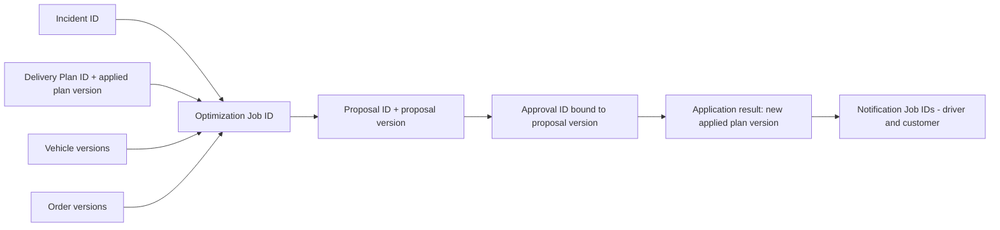

A proposal carries a **base snapshot descriptor** (plan version + vehicle versions + order versions + incident versions, names NV). Every command that depends on it sends that descriptor or the proposal version so the server can reject stale use.

## G.3 Required Invariants (client + server)

| Hazard | Prevention |
|---|---|
| Applying an obsolete plan | Server compares snapshot at apply; client disables Apply on superseded events and shows blocking banner; apply request includes `proposalVersion` + `approvalId`. |
| Overwriting newer operational data | Apply is a compare-and-set on plan version; mismatch → 409. Client never writes assignments directly. |
| Reopening completed deliveries | Completed stops excluded from job input and flagged immutable in proposal; server rejects any proposal touching them; UI renders no editing controls for them. |
| Approval displayed for the wrong plan version | Approval banner shows `proposalVersion` and approver; selector ties approval to proposal ID+version; navigating to another version resets approval display. |
| Duplicate commands after retry | Idempotency key per user intent; ledger retained until reconciled; buttons disabled while pending or reconciling. |
| Stale incident status after reconnect | On reconnect, refetch active incidents and jobs before re-enabling mutating controls; events older than cached version dropped. |

---

# H. Optimistic UI Protocols and Rollback

## H.1 Policy Table

| User Action | Optimistic Update Allowed? | Immediate UI Change | Server Confirmation | Rollback Strategy | Conflict Handling | Retry Policy |
|---|---|---|---|---|---|---|
| Search/filter/sort change | **Yes** (local) | Controls + URL update | Refetch result | Revert to last successful query if first load fails | Latest-request-wins; cancel stale in-flight | Auto-retry GET ≤3 w/ backoff (matches §I.1) |
| Select vehicle/route/stop/order | **Yes** (local) | Highlight | None | Clear if entity vanishes | Server removal → deselect + info toast | n/a |
| Open/close overlays | **Yes** (local) | Immediate | None | n/a | n/a | n/a |
| Edit incident draft (local) | **Yes** | Field values | Save draft | Keep local on failure | Server newer → diff prompt | Manual |
| Save editable metadata (non-operational, e.g., notes, preferences) | **Yes, provisional** | Show value with "Saving…" marker | Canonical response replaces | **Targeted** field rollback to captured previous value | 409 → show both; user chooses | Idempotent PUT/PATCH with version: ≤2 auto w/ jitter |
| Submit incident | **Limited**: show row "Submitting…" in a local pending list; **not** as a confirmed incident status | Form read-only | Server returns canonical incident ID | Remove pending row; restore form | Duplicate key → return existing | No auto-retry unless idempotency key honored (NV); else reconcile first |
| Confirm disruption / dismiss | **No** | Spinner only | Canonical status | n/a | 409 → refetch | Manual after reconcile |
| Start optimization | **No** status change; may show "Starting…" | Progress panel in "Starting" | Job ID + status | Close panel if rejected | Active-job conflict → link | Same key retry on unknown outcome after status query |
| Approve plan | **No (safety rule)** | Pending spinner in dialog | Server approval record | n/a | Stale → blocking banner | Query before retry |
| Apply approved plan | **No (safety rule)** | "Applying…" progress | Server application result + new applied version | n/a | Stale/422 → show; unknown → Reconcile | Never auto-retry |
| Reject proposal | **No** (reason preserved) | Spinner | Canonical rejected state | Keep dialog open | Already superseded → inform | Manual; idempotent by key |
| Send/retry notifications | **No** delivery claims | Row shows "Requested/Pending" only after server accepts request | Per-recipient job states | n/a | Partial results per row | Per-row retry; batch retry targets failed only |
| Cancel job/incident | **No** | "Cancelling…" | Server terminal state | Revert label if rejected | Completed-first race → show completed | Safe to repeat cancel (idempotent) |

Cosmetic vs authoritative: rows 1–4 are cosmetic local interactions. All others touching operational data are server-confirmed.

## H.2 Mandatory Sequence for Every Provisional Mutation

1. **Capture** previous entity value *and version*.
2. **Apply** only the permitted provisional change, tagged `pending: opKey`.
3. **Attach** unique `opKey` (idempotency key) to the request and ledger.
4. **Deduplicate**: disable control and ignore repeats for the same intent.
5. **Await** authoritative response (or reconcile on unknown outcome).
6. **Replace** provisional value with the canonical server entity.
7. **On rejection**: roll back **only the fields touched by this op**, or reconcile to server value.
8. **Preserve** unrelated updates received while pending (apply them to cache; they are not part of this op).
9. **Show** meaningful error with next action (Retry, Review, Contact).
10. **Version guard**: ignore a response whose entity version is older than the cached version.

## H.3 Why Whole-Cache Rollback Is Unsafe

Snapshot-and-restore of the entire cache reverts every change made after the snapshot — including unrelated realtime updates (a new incident, a vehicle becoming unavailable, a stop completing). In a dispatch tool this can *resurrect completed or reassigned state*, hide a newly confirmed disruption, or briefly re-enable a control the server has already disabled. Rollback must therefore be **field-level and version-aware**, followed by a refetch of the affected entity.

---

# I. Network, Retry, and Re-authentication Protocols

## I.1 Standard Behavior Table

| Condition | Detection | UI | Retry eligibility | Notes |
|---|---|---|---|---|
| Network unavailable | `navigator.onLine` + failed probe/request | OV-17 banner; mutating buttons disabled with reason | Auto refetch on reconnect | Local drafts preserved |
| Request in flight when connectivity lost | Fetch error/abort | Op marked **Unknown**; ledger entry | **Not** auto-retried for non-idempotent | Reconcile after reconnect |
| Timeout, unknown mutation outcome | Client timeout (GET 10 s, mutation 15 s — Proposed) | T-10 + "Verifying result" | Query authoritative state first | Duplicate command blocked until known |
| Auth expiry during submit | 401 | OV-15; op paused | After re-auth, reconcile by opKey then resume if not applied | Safe form data kept in memory |
| 401 | — | OV-15 | Safe after re-auth | Never loop re-auth; max 1 silent refresh |
| 403 | — | Permission message | No | Refresh permissions |
| 409 | — | Conflict explanation w/ refetch | Only after user review | Stale plan → regenerate flow |
| 422 | — | Field/constraint detail | No automatic | Infeasible-plan errors map to explanation panels |
| 429 | — | "Too many requests" + wait | After `Retry-After` for idempotent/keyed requests | Jitter |
| 5xx | — | Error + Retry | GET: auto ≤3; idempotent/keyed mutation: ≤2; else manual | Show correlation ID |
| Routing engine failure | Job failed w/ cause (NV) | OV-06 | New job allowed | Show if degraded fallback used, labeled |
| Optimization timeout | Job TimedOut | OV-06 | New job allowed | Preserve completed prior proposal as superseded context |
| Notification provider failure | Per-recipient `Failed` | T-08, R-15 rows | Per-row manual/bounded auto (Proposed ≤2) | Manual fallback list |
| Partial batch success | Mixed statuses | Itemized result | Retry failed subset only | Never show overall success unless all accepted |

## I.2 Backoff Policy (Proposed)

`delay = min(cap, base × 2^attempt) × random(0.5–1.0)`; base 500 ms, cap 8 s (REST), 30 s (realtime reconnect); max attempts per above table; aborts on navigation away unless operation is a tracked mutation; `AbortController` for superseded GETs. Every retry and reconciliation rule in §H and §I assumes the backend supports idempotency keys and an outcome query by `opKey` (Q-19).

## I.3 Ambiguous Timeout After Approve/Apply

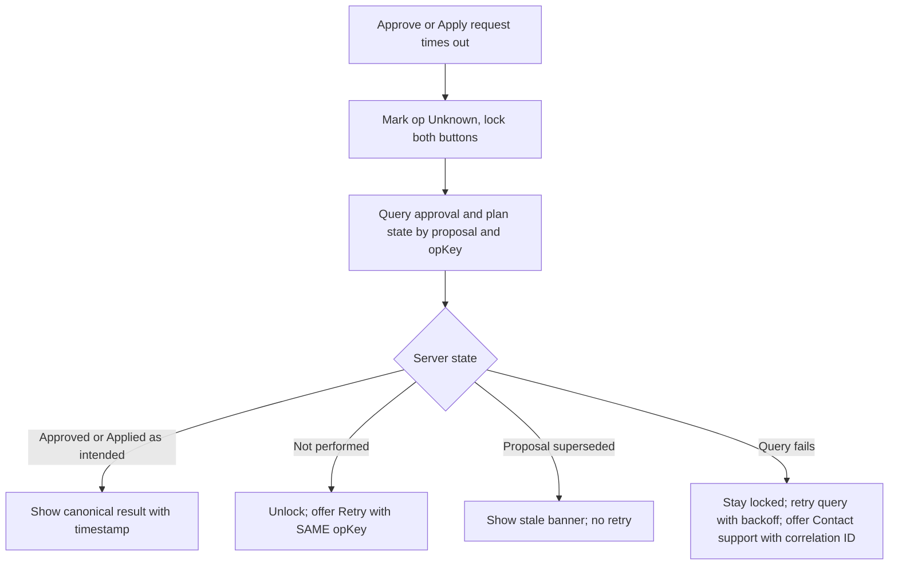

## I.4 Re-authentication Protocol

1. Preserve safe unsent form data in memory (and draft storage for incident forms); never store credentials.
2. Pause protected operations and realtime channel.
3. Present OV-15 (in-place) or redirect to `/login?returnTo=…&reason=expired` if the auth mechanism requires.
4. After success, restore the original URL and overlay context where safe (not OV-08/OV-10 — those are re-opened fresh after validity re-check).
5. Reconcile pending ledger entries by `opKey` **before** any resubmission.
6. Tokens never in URLs, logs, analytics, or user-visible errors; error displays use correlation IDs only.

---

# J. Core Logistics Domain Invariants

The UI **communicates and enforces through server-confirmed state**. The client never computes feasibility itself; it displays server validation and disables actions accordingly.

## J.1 Completed Deliveries

| Rule | UI behavior |
|---|---|
| Completed deliveries/stops are immutable during replanning (INV-01) unless a separately authorized correction workflow exists (**not defined**; Q-09) | Lock icon + "Completed {time}" label; no edit/reassign controls; excluded from job scope list shown in R-13 |
| Historical records persist across recalculation | Plan and route views always include completed stops, even after apply; "Show completed" default **on** |
| Distinct stop states on every route visual | **Completed** (filled check + gray-blue), **Active/in progress** (pulse-free ring + label), **Proposed** (dashed outline + "Proposed"), **Unassigned** (warning triangle + "Unassigned") — each with icon *and* text, not color alone |
| "Dispatched/in progress" ≠ completed | Only server `completed` stops lock; in-progress stops may be reassigned subject to server rules (Q-10: is a stop already "arrived" replannable?) |

## J.2 Vehicle Capacity

- Server validates weight and volume per vehicle for every proposed route; a proposal is never marked "Valid" with violations (INV-02).
- R-14 shows per-vehicle load bars: weight % and volume % with numeric values and text, plus **before → after**.
- When no vehicle can carry an order, the unassigned explanation names the binding constraint (e.g., "Weight: needs 420 kg; max remaining across available vehicles is 310 kg").
- Capacity data missing for a vehicle → vehicle excluded and flagged ("Capacity unknown"), not assumed unlimited.

## J.3 Customer Delivery Windows

| Class | Definition | Display |
|---|---|---|
| Feasible | ETA inside window with buffer | "On time" |
| At risk | ETA within window but within buffer threshold (threshold is a config, Q-11) | "At risk" + margin |
| Late | ETA after window close | "Late by {mm}" |
| Unassigned | No feasible placement | "Unassigned" + reason |

If a solution must violate windows, the proposal states the unavoidable violations with explanation (e.g., "No available vehicle can reach before 14:00 after closure on {road}"), and approval requires acknowledging late/unassigned counts in OV-08.

## J.4 Human Approval

- R-14 presents: reassigned vehicles/stops, ETA changes, window impact, unassigned orders, and cost/distance/fuel/emissions deltas **marked as estimates with calculation basis** (NV whether the backend provides these).
- Approval binds to `proposalId + proposalVersion + snapshot` (INV-04). Any material source-data change → proposal marked Superseded; prior approval voided; UI requires a new review.
- "Material change" examples: vehicle availability change, order added/canceled/changed, stop completed in scope, newer incident touching the same routes, plan version changed by another apply. Immaterial (e.g., metadata edit) does not invalidate. **Materiality list is a product/backend decision (Q-04).**

## J.5 Dynamic Replanning and Concurrent Incidents

| Scenario | Proposed rule |
|---|---|
| New incident while job Running, **disjoint** scope | Allowed in parallel (if backend supports) or queued; each yields its own proposal; apply serializes via plan version compare-and-set. |
| New incident, **overlapping** scope while job Running | Running job marked Superseded when snapshot changes; system (or dispatcher, per Q-06) starts a merged job covering both incidents; UI explains "Plan updated because incident B was reported". |
| New incident while proposal awaiting approval | Existing proposal flagged "May be outdated"; if overlapping → Superseded; if disjoint → still valid until apply-time compare-and-set check. |
| Two dispatchers act on same incident | Server-side status checks; second actor receives 409 + latest state. |
| Re-optimization after applied plan | New job uses applied plan version as base; completed stops frozen. Entry: R-13 "Replan" on a new/reopened incident; no direct "re-run" of an applied proposal. |
| Progress display | Show elapsed time and discrete phases (Preparing → Solving → Validating) only if backend reports phases; otherwise indeterminate "Working…" — never a fake percent or "Complete" before Validating finishes. |
| Scope | Recompute only affected routes when the backend supports scoped solving; global feasibility checks still run (NV). UI shows scope description. |

## J.6 Voice and Notifications

- **Transcription success ≠ incident submission.** Transcript lands in OV-19 and then in the form; nothing is submitted until the explicit Submit.
- **Request acceptance ≠ delivery.** Notification jobs created after apply show `Pending` (request accepted); `Sent`/`Delivered`/`Failed`/`Unknown` only as the provider supports (NV). Without receipts, final state is **Unknown**, not "Delivered".
- Applied plan + failed notifications is a valid, visible state: dashboard badge "Plan applied — {n} notifications need attention".
- Manual fallback: copyable message text, call list with phone (permission-gated), "Mark contacted manually" (Proposed).
- Voice failure fallback: typed form is always available; STT outage never blocks reporting.
- Customer contact data masked by default; full view requires permission (Q-12).

## J.7 Performance Target (Not a Guarantee)

| Item | Definition |
|---|---|
| Target | Replanning computation completes within **2 seconds** under **typical workloads** (workload envelope not defined; Q-05). This is a **target, not a guarantee**; no measured results are claimed here. |
| Measurement start | Server receives start-optimization request with snapshot (server-side metric `optimization_started_at`). Client-observed latency measured separately from click to first rendered result. |
| Measurement end | Proposal persisted and validated (`Completed`). Client-observed: proposal visible. Excludes human review time and apply time. |
| Soft threshold | At 2 s unfinished → "Still working…" notice (not an error). |
| Hard timeout | Configurable (Proposed default decided in Q-05). On expiry → TimedOut; OV-06. |
| Degraded mode | Options (**Proposed, NV**): return best-so-far feasible solution flagged "Partial/Time-limited", or fall back to cached travel-time matrices flagged "Estimated travel times". Degraded proposals are visibly labeled and require the same approval. |
| Background completion | Job may continue server-side after UI timeout; result surfaces if still current, otherwise discarded as Superseded. |
| Routing-engine latency | Counted inside the 2 s target; tracked separately in telemetry. |

---

# K. Accessibility and Responsive Behavior

| Area | Requirements |
|---|---|
| Keyboard | All functions operable by keyboard; no keyboard traps outside modals; visible focus ring (≥3:1 contrast); logical tab order; map controls reachable; `Esc` rules per §F. |
| Focus | On route change → `<h1>`; after overlay close → trigger; after async result → live region, not forced focus (except errors on form submit → error summary). |
| Screen reader | Landmarks (`header`, `nav`, `main`); table headers/`scope`; `aria-sort`; `aria-current`; live regions: polite for progress/status, assertive for failures and critical incidents. Debounce progress announcements (≥5 s). |
| Loading/progress | `aria-busy`, textual status ("Generating recovery plan, 6 seconds elapsed"), no spinner-only communication. |
| Color independence | All statuses use icon + text (Completed, Active, Proposed, Unassigned, At risk, Late, Failed). Contrast ≥ WCAG AA. |
| Map alternatives | Every map has a synchronized, fully functional list/table view and a textual route summary ("Truck T-12: 8 stops, 3 completed, next: …"); markers focusable via list; map not required to complete any task. |
| Responsive tables | Horizontal scroll with sticky first column or card layout < 768 px; no information loss. |
| Responsive navigation | Per §C; touch targets ≥ 44×44 px. |
| Voice-recording controls | Native buttons with labels ("Start recording"/"Stop recording"), state announced; timer in text; level meter has text alternative; keyboard-operable; visual indicator not color-only; **typed alternative always offered**. |
| Reduced motion | Respect `prefers-reduced-motion`: no pulsing markers, animated route drawing, or sliding overlays. |
| High-impact confirmations | Approve/Apply/Reject/Cancel use explicit confirmation dialogs (`alertdialog` for destructive), summarizing consequences; default focus on the safe option; no single-keystroke commit. |
| Time-limited actions | No session-timeout surprises: warn ≥ 2 min before expiry if mechanism supports (NV). |

---

# L. Observability and Analytics

**Status:** No analytics provider or event convention verified. Names below are **Proposed**. No telemetry vendor is assumed.

## L.1 Events

| Event | Trigger | Required payload (IDs and non-sensitive fields) |
|---|---|---|
| `incident_created` | Draft created | `incidentId`, `type`, `source` (form/voice), `severity?` |
| `incident_submitted` | Server confirms submit | `incidentId`, `type`, `severity`, `source`, `clientLatencyMs` |
| `incident_confirmed` | Confirmed | `incidentId`, `timeToConfirmMs` |
| `voice_recording_started/denied/transcribed/failed` | Voice steps | `incidentDraftId`, `durationMs`, `errorCode` (no transcript text) |
| `optimization_started` | Job accepted | `incidentId`, `jobId`, `scopeCounts`, `isReoptimization` |
| `optimization_completed` | Job Completed | `jobId`, `serverDurationMs`, `clientObservedMs`, `affectedOrders`, `unassignedOrders`, `degraded` |
| `optimization_failed` / `optimization_timed_out` | Terminal failure | `jobId`, `cause`, `elapsedMs` |
| `proposal_reviewed` | R-14 viewed with validity OK | `proposalId`, `version`, `reviewDurationMs` |
| `proposal_approved` / `proposal_rejected` | Server confirms | `proposalId`, `version`, `approverRole`, `reasonCategory?` |
| `plan_application_started/succeeded/failed` | Apply lifecycle | `proposalId`, `appliedPlanVersion`, `durationMs`, `errorCode` |
| `proposal_superseded` | Stale | `proposalId`, `supersededBy`, `reasonCode` |
| `notification_requested/sent/failed` | Job states | `notificationJobId`, `channel`, `recipientType`, `count`, `errorCode` |
| `reoptimization_started` | New job after apply | `incidentId`, `jobId`, `baseAppliedVersion` |
| `mutation_outcome_unknown` | Timeout w/o answer | `opKey`, `operationType` |
| `realtime_disconnected/reconnected` | Channel | `downMs` |

## L.2 Rules

- **Correlation IDs** carried on every event and API request header: `incidentId`, `jobId`, `proposalId`+`version`, `appliedPlanVersion`, `notificationJobId`, plus a client `sessionId` (non-credential) and `opKey`.
- **Exclude**: credentials, tokens, full transcripts/audio, customer names/phones/addresses, free-text descriptions.
- Count/aggregate rather than record sensitive content.

## L.3 Operational Measures

| Measure | Definition |
|---|---|
| Time to feasible plan | `optimization_started` → `optimization_completed` (server) and → proposal visible (client) |
| Time to approve and apply | `proposal_reviewed` → `proposal_approved`; approved → `plan_application_succeeded` |
| Affected / unassigned orders | Counts per job |
| On-time delivery impact | Δ on-time / at-risk / late counts vs prior plan |
| Fuel, distance, cost, emissions deltas | As provided by backend; flagged estimate vs measured |
| Notification success rate | Delivered (or Sent where no receipts) / requested, by channel |
| Optimization timeout / failure rate | Per-day, by cause |
| Stale-apply rejection rate | 409 stale at apply / apply attempts |

---

# M. QA Acceptance Criteria

Format: **Initial state → Action → Expected UI → Expected server state → Recovery.** IDs map to §N.

| ID | Scenario | Initial state | Action | Expected UI | Expected server state | Recovery |
|---|---|---|---|---|---|---|
| QA-01 | Login & session restore | Logged out, valid user | Sign in; reload | Dashboard; after reload splash then dashboard | Valid session | If restore fails → login with `returnTo` |
| QA-02 | Protected deep link | Logged out | Open `/app/incidents/INC-1` | Login; after sign-in lands on same URL | No mutation | Invalid `returnTo` → dashboard |
| QA-03 | Forbidden route | Viewer role | Open `/app/admin/users` | Access-denied screen | None | Link to dashboard |
| QA-04 | Incident create + duplicate prevention | R-12 filled | Double-click Submit | Single pending state; one incident | One incident for one key | Timeout → query by key; no duplicate |
| QA-05 | Mic permission denied | R-12 | Record → deny | Fallback message, typed input available | None | User can submit manually |
| QA-06 | Transcription failure | Recording done | Upload → STT error | "Couldn't transcribe" w/ Retry/type manually; recording retained | No incident created | Retry or manual |
| QA-07 | Vehicle breakdown | Active plan, truck T on route | Report breakdown; confirm; replan | Affected stops listed; proposal produced | Incident confirmed; job Completed; plan unchanged until apply | — |
| QA-08 | Road closure | Plan with routes through road R | Report closure; confirm; replan | Proposal avoids R or flags infeasible | Same | — |
| QA-09 | Feasible result | Capacity available | Replan | Proposal "Valid"; deltas shown | Proposal v1 stored | — |
| QA-10 | Infeasible result | No capacity for order O | Replan | Order O unassigned with named constraint | Proposal w/ unassigned list or Failed(infeasible) per backend | Offer relax/defer options (creates new job) |
| QA-11 | Capacity enforcement | Order exceeds all vehicles' remaining capacity | Replan | Never assigned; reason shows weight/volume | Server validation rejects any such assignment | — |
| QA-12 | Time-window enforcement | Window cannot be met | Replan | Marked Late or Unassigned with explanation; approval dialog lists count | Server marks windows | — |
| QA-13 | Completed deliveries preserved | 3 completed stops on route | Replan → apply | Completed stops visible, locked, unchanged before/after | Completed records unchanged; proposal excludes them | Any proposal touching them rejected 422 |
| QA-14 | Approval | Proposal opened for review (`under_review`) | Approve via OV-08 | Approved banner (persistent) after server OK; Apply enabled | Approval bound to version | Failure keeps dialog/err |
| QA-15 | Rejection | Proposal opened for review (`under_review`) | Reject w/ reason | Rejected; incident Confirmed; "Generate new plan" | Reason stored; no plan change | Reason retained if failure |
| QA-16 | Stale plan detection | Proposal awaiting approval | Another incident changes overlapping vehicle | Blocking "Plan outdated" banner; Approve/Apply disabled | Proposal Superseded; apply returns 409 | Regenerate |
| QA-17 | Apply with stale snapshot (race) | Approved proposal; data changed just before apply | Click Apply | Error "Plan is outdated"; no change claimed | No mutation | Regenerate |
| QA-18 | Timeout unknown outcome | Approve request sent | Simulate timeout after server commit | "Verifying result" then Approved shown; no duplicate approve | Single approval | Query by opKey |
| QA-19 | Re-auth mid-operation | Apply pending | Force 401 | OV-15; after login, outcome reconciled; destination restored | At most one application | No auto-resubmit before reconcile |
| QA-20 | Notification partial failure | Plan applied; 5 drivers/10 customers | 2 customer notifications fail | Itemized statuses; badge; retry failed only | Jobs: some Failed | Retry/manual fallback |
| QA-21 | Concurrent incidents | Job Running for incident A | Report overlapping incident B | A's job Superseded with explanation; merged/new job | Single winning applied plan version | — |
| QA-22 | Network disconnect/reconnect | On R-13 | Go offline 30 s, return | Offline banner; mutations disabled; on reconnect data refetched; no stale statuses | Unchanged | Pending ledger reconciled |
| QA-23 | Refresh during optimization | Job Running | Reload page | Page restores, shows job progress or completed result | Job continues | Job lookup by incident |
| QA-24 | Performance target behavior | Typical test dataset | Replan | If >2 s shows "Still working…"; if hard timeout → OV-06; **no assertion that 2 s is always met** | Timing metrics recorded | Retry / reduce scope |
| QA-25 | Keyboard operation | Any | Complete report → replan → approve with keyboard only | All reachable; focus order logical; dialogs trap & restore | — | — |
| QA-26 | Screen reader | Any | Run flow with SR | Status/progress announced; map list alternative works; statuses not color-only | — | — |
| QA-27 | Responsive | 360, 768, 1280 px | Use navigation, tables, R-14 | Drawer nav; tables scroll/cards; no horizontal page scroll | — | — |
| QA-28 | Unsaved changes | R-12 dirty | Click nav link/back | OV-14; Stay keeps data | — | Draft restore |
| QA-29 | Duplicate approve/apply | Two tabs | Approve in both | Second gets conflict/"already approved" | One approval | Refetch |
| QA-30 | Completion race | Cancel pending when job finishes | Cancel optimization | Shows completed result, not "cancelled" | Job Completed | — |
| QA-31 | Urgent order disruption (**conditional on Q-13**) | Confirmed urgent order O with active plan | Report urgent order; confirm; replan | Affected routes listed; proposal inserts O or lists O as unassigned with reason | Incident confirmed; job `completed`; live plan unchanged until apply | If out of scope per Q-13, mark test N/A |
| QA-32 | Missing unassigned reason | Proposal contains unassigned order with no reason | Open R-14; open OV-11 | Row shows "Reason not provided" defect state; OV-08 flags missing-reason count | Proposal unchanged | Report-issue affordance; approve policy per Q-10/INV-10 |
| QA-33 | Superseded deep link | Proposal P1 superseded by P2 | Open R-14 for P1 via bookmark; refresh | Blocking "Superseded" banner with link to P2; Approve/Apply absent | P1 `superseded`; P2 current | Follow link; P1 stays read-only |
| QA-34 | Notification max attempts | Customer notification failed 3 times | Open R-15 row | Retry disabled with reason; "Mark contacted manually" + copyable script offered | Job `failed`, attempts at max | Manual contact requires note; row → `manual_contacted` |
| QA-35 | Logout with server failure | Active session; logout endpoint failing | Logout | `/login?reason=loggedout`; warning that server session may persist | Server session may remain | Local credentials, caches, realtime channel cleared regardless |
| QA-36 | Retryable apply failure | Approved proposal; commit fails and rolls back | Apply | Error shown; "Apply" available again; no change claimed | Proposal `apply_failed`→`approved`; plan version unchanged | Retry creates new `opKey`; if snapshot stale → superseded |
| QA-37 | Cancel not allowed while applying | Incident `applying` | Attempt cancel (UI and direct API) | Cancel control absent/disabled with reason | API returns 409 `invalid_transition`; state unchanged | Wait for `resolved` or `awaiting_approval` |
| QA-38 | Older proposal cannot overwrite newer plan | Plan version 7 applied from P2; stale approved P1 exists | Attempt apply P1 | Error "Plan is outdated"; Apply never enabled for P1 | 409 `plan_stale`; plan version stays 7 | Regenerate from current plan |

---

# N. Traceability Matrix

PRD IDs are assigned here (**PRD-xx**) for traceability because the source brief is unnumbered. Implementation status is **Not Verified** for all rows.

| PRD ID | Requirement | Screen/Route | User action | State transition | Backend dependency | Failure behavior | Acceptance test | Impl. status |
|---|---|---|---|---|---|---|---|---|
| PRD-01 | Authenticated workspace | R-02, R-04 | Sign in | Session: none→active | Auth API | §D1, §I | QA-01, 02, 03 | NV |
| PRD-02 | Fleet & plan visibility | R-04,06,07,08,09,10 | Browse/filter | Query: idle→loading→success or error (§G); stop: `pending`→`en_route`→`in_progress`→`completed` (read-only display) | Vehicles/plans/stops APIs | Inline errors | QA-27 | NV |
| PRD-03 | Incident reporting & lifecycle | R-11,12,13 | Create/submit/confirm | D3 | Incident API | 409/422 handling | QA-04, 07, 08, 28 | NV |
| PRD-04 | Breakdown / vehicle unavailability | R-12,13 | Report breakdown | Incident confirmed → replan | Incidents, vehicle status | §D5 | QA-07 | NV |
| PRD-05 | Road closure / infeasibility | R-12,13,14 | Report closure | Job with closure input | Routing engine, optimizer | Routing failure OV-06 | QA-08 | NV |
| PRD-06 | Urgent orders (where supported) | R-12,13 | Report urgent order | As D3/D4 | Orders API | — | QA-31 (conditional on Q-13) | NV / Proposed |
| PRD-07 | Traffic-aware replanning | R-13,14 | Generate plan | D4 | Routing traffic data | Degraded label | QA-09, 24 | NV |
| PRD-08 | Capacity constraints | R-14 | Review loads | Validation | Optimizer + validation | Unassigned reason | QA-11 | NV |
| PRD-09 | Delivery time windows | R-14 | Review ETAs | Classification | Optimizer | Late/unassigned explanation | QA-12 | NV |
| PRD-10 | Vehicle availability/feasibility | R-07,13,14 | — | Vehicle excluded | Vehicle status | Flagged | QA-07 | NV |
| PRD-11 | Preserve completed deliveries | R-09,10,14 | View/replan | Frozen stops | Stop status, apply logic | 422 on violation | QA-13 | NV |
| PRD-12 | Human approval before apply | R-14 | Approve/reject/apply | D4b | Approval + apply API | Stale/409 | QA-14, 15, 16, 17, 29 | NV |
| PRD-13 | Explain unassigned/infeasible | R-14, OV-11 | "Why?" | Job `validating`→`completed` with unassigned list; UI: OV-11 closed→open | Reason codes | "Reason unavailable" defect | QA-10, 32 | NV |
| PRD-14 | Driver comms | R-15, OV-12 | Retry/send | Notification job lifecycle | Notification service | Partial failure | QA-20 | NV |
| PRD-15 | Customer voice notifications | R-15, OV-13 | Retry/send | Notification job lifecycle | TTS/voice provider | Provider failure | QA-20 | NV |
| PRD-16 | Voice incident reporting | R-12, OV-03/04/19 | Record/transcribe | Draft fill | STT | Permission/transcribe failure | QA-05, 06 | NV |
| PRD-17 | Before/after comparison (cost, distance, fuel, emissions, impact) | R-14 | Compare | UI-only `compare` query param before→after→split; data from proposal metrics (NV) | Metrics from optimizer (NV) | "Not available" (Q-15) | QA-09 | NV / Partial? |
| PRD-18 | Re-optimization after later disruption | R-13 | Replan | D4 w/ applied base | Optimizer | Supersede flow | QA-21 | NV |
| PRD-19 | 2-second replanning target | R-13 | Generate | D4 timing | Optimizer, routing | Soft/hard timeout | QA-24 | NV |
| PRD-20 | Monitor execution | R-04, 09, 10 | Observe | Stop `in_progress`→`completed` via server completion event; incident `resolved` is not delivery completion | Realtime/polling | Reconnect | QA-22, 23 | NV |
| PRD-21 | Stale/superseded plans never applied | R-14, R-13 | Approve/apply old proposal | D4b `superseded`; D4 `completed`→`superseded` | Snapshot/version compare-and-set | 409 `plan_stale`; blocking banner | QA-16, 17, 33, 38 | NV |
| PRD-22 | Safe recovery from network/session failure | All mutating screens, OV-15, OV-17 | Any mutation during outage/expiry | Ledger: InFlight→Unknown→Reconciling→Confirmed/NotApplied | `opKey` outcome query; idempotency (NV) | "Verifying result"; no duplicate command | QA-04, 18, 19, 22, 35 | NV |
| PRD-23 | Accessible, responsive operation | All routes | Keyboard/screen-reader/mobile use | UI-only (focus, live regions) | None | Map failure → list fallback | QA-25, 26, 27 | NV |
| PRD-24 | Cancel and recover from failed or unwanted work | R-13, OV-05, OV-06, OV-16 | Cancel job/incident; retry failed apply or notification | D3 `cancelled`; D4 `cancelled`; D4b `apply_failed`→`approved`; notification `failed`→`pending`/`manual_contacted` | Cancel, apply, notification APIs | Completion race; not cancellable while `applying` | QA-30, 34, 36, 37 | NV |

---

# O. Consistency and Completeness Audit

Self-audit of this document (not of an implementation).

| # | Check | Result | Notes |
|---|---|---|---|
| 1 | Every route has auth + authorization | **Pass** (§B.3) | R-01/R-02/R-20 are public by design |
| 2 | Primary actions have success + failure paths | **Pass** (§E) | |
| 3 | Async ops have pending/success/failure | **Pass** (§D4, §E, §I) | |
| 4 | High-impact mutations server-confirmed | **Pass** (§H, INV-07) | |
| 5 | Modals have triggers + dismissal rules | **Pass** (§F.1) | |
| 6 | Transitions have guards + invalid cases | **Pass** (§D3 table; §D4c per-edge guards for the job, proposal/approval/application, and notification machines) | Guards are Proposed and unverified against backend enums (§P-07) |
| 7 | Mermaid syntax valid | **Pass** — all 11 blocks rendered with `mmdc` (headless Chrome 131) on 2026-10-11 after the v0.2 edits | Syntax only, not semantic correctness. Re-run in CI after any edit (§P-14) |
| 8 | Names/IDs consistent | **Pass** — scripted check: every `R-`, `OV-`, `QA-`, `PRD-`, `Q-`, `INV-` identifier is defined exactly once and every reference resolves; every table row matches its header's column count; state-name convention stated in §A.3 | Scripted checks cover identifiers and table shape, not prose meaning |
| 9 | Lifecycles distinct | **Pass** (D3 vs D4 vs D4b) | Reconciliation with backend job states pending (Q-03) |
| 10 | Completed deliveries preserved | **Pass** (INV-01, §J.1) | |
| 11 | Capacity + windows enforced | **Pass** (§J.2, J.3) — server-enforced assumption NV | |
| 12 | Unassigned orders explained | **Pass** (OV-11, INV-10) | |
| 13 | Stale plans can't overwrite | **Pass** (§G.3, §H) | |
| 14 | Proposed/unverified labeled | **Pass** with the global NV banner; individual rows tagged where specific | |
| 15 | No undocumented APIs claimed implemented | **Pass** — no endpoint paths are specified | |
| 16 | Usable without inferring missing transitions | **Partial** | Incident, job, proposal, approval, application, and notification transitions are fully specified (§D3, §D4c). Still requires backend facts: realtime event schema, exact enum spellings (§P-07), materiality list (Q-04), stop-state vocabulary beyond `completed` |

---

**Audit method and limits.** Items 1, 2, 3, 5, 9–15 were checked by reading the cited sections. Items 7 and 8 were checked by tooling (`mmdc` render; identifier and table-shape script). Item 6 was re-checked after adding §D4c. A **Pass** means the *document* is internally complete and consistent; it says nothing about whether any code implements it (all implementation status is **Not Verified**).

---

# P. Repository Verification Checklist

Run these to convert this draft into a verified spec. For each, update the relevant section and change *NV* tags.

| # | Verify | Updates |
|---|---|---|
| P-01 | Frontend entry, router config (React Router? Next.js? other), route files | §B (routes, rendering mode), §C |
| P-02 | Layouts, auth guards, error boundaries | §B, §D1 |
| P-03 | State/data libraries and stores | §G |
| P-04 | API client, interceptors, timeouts, retry, idempotency headers | §H, §I |
| P-05 | Realtime: WebSocket/SSE use, event schema, cursor/resume | §D5, D6, §C |
| P-06 | Backend routers, Pydantic schemas, error codes (409/422 semantics) | §E, §I |
| P-07 | Enums: incident status, job status, proposal/approval status, notification status | §D3, D4, D4b |
| P-08 | DB models for plan versions, stop completion, snapshots | §G, §J |
| P-09 | OR-Tools service: constraints, time limits, scoped solving, partial results | §J.5, J.7 |
| P-10 | Routing: OSRM vs Valhalla, traffic data support | §A.5, §J |
| P-11 | Voice: STT/TTS providers, formats, limits, receipts | §E.5, §J.6 |
| P-12 | Roles and permissions model | §A.6, §B |
| P-13 | Existing docs/tests (PRD, E2E tests) | §M, §N |
| P-14 | Mermaid lint (e.g., a CLI renderer in CI) | §D |
| P-15 | Analytics/logging conventions | §L |

---

# Q. Unresolved Decisions and Assumptions

## Assumptions Made (due to no repository)

1. Frontend is a client-rendered React SPA; no SSR/SSG is assumed.
2. A session credential exists with silent refresh at most once; actual mechanism unknown.
3. The backend supports (or will support) idempotency keys, version/compare-and-set on plan application, and returns structured reasons for unassigned orders.
4. Notification providers may or may not return delivery receipts; UI handles both.
5. Realtime transport may be WS, SSE, or polling; polling fallback is specified.
6. All overlays, events, role names, permission names, and route names are proposals.

## Contradictions Between Requirements and Existing Code

None identified, because **no existing code was available** (see header). Section §P lists exactly what to inspect; every contradiction found there must be recorded here with the resolution (code wins, requirement wins, or decision escalated to a Q-item).

## Open Decisions

| ID | Question | Impact |
|---|---|---|
| Q-01 | Who may approve proposals? Dispatcher only, or supervisor for high-severity/high-impact plans? | §A.6, OV-08, permissions |
| Q-02 | Keep approve and apply as two steps (recommended) or allow a combined action? | R-14, safety |
| Q-03 | Exact backend job/proposal states; are "awaiting approval/applying/applied" job states or proposal states? | D4/D4b |
| Q-04 | Which data changes are "material" and invalidate approval? | §J.4 |
| Q-05 | Workload envelope for the 2 s target; hard-timeout values; degraded-mode policy | §J.7 |
| Q-06 | On overlapping incidents: auto-merge or require dispatcher decision? | §J.5 |
| Q-07 | Duplicate incident policy (same vehicle/type open) | §E.5 |
| Q-08 | 403 vs 404 policy for resources user can't see | §B.4 |
| Q-09 | Is there any correction workflow for completed deliveries and any manual stop editing? | §J.1 |
| Q-10 | Is an "arrived/in-service" stop replannable? | §J.1 |
| Q-11 | At-risk window buffer thresholds | §J.3 |
| Q-12 | Customer PII visibility and masking rules; call-time restrictions | §J.6 |
| Q-13 | Is urgent-order disruption in scope for current release? | PRD-06 |
| Q-14 | Is onboarding (R-03) and admin (R-18) required? | §B |
| Q-15 | Does the backend provide before/after cost, distance, fuel, emissions, or must the client compute (not recommended)? | PRD-17 |
| Q-16 | Driver acknowledgement support and channel (app, SMS, voice) | §E.8 |
| Q-17 | Does opening R-14 record review start (`generated`→`under_review`) server-side, or may approve accept `generated` directly? | §D4c, QA-14 |
| Q-18 | Maximum notification retry attempts (Proposed 3) and who may mark a notification manually contacted | §D4c, §J.6 |
| Q-19 | Does the backend support idempotency keys and an outcome query by `opKey`? Every retry and reconciliation rule in §H/§I depends on it | §G, §H, §I |

---

*End of Appflow.md — v0.2 (requirements-derived; verification pending).*
