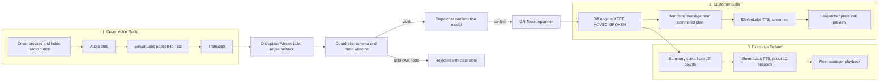

<div align="center">

# ReRoute: Disrupted Deliveries, Rerouted by Voice
### AI-Assisted Dynamic Fleet & Delivery Replanning

*When the morning plan breaks, ReRoute re-plans only what is left, and a human stays in control.*

**Team TechBaazi · VORTEXA 3.0 · Domain 4: Supply Chain & Optimization · Problem S-01**

</div>

---

## Table of Contents

1. [Project Overview](#1-project-overview)
2. [Key Features & Problem Statement Alignment](#2-key-features--problem-statement-alignment)
3. [ElevenLabs Audio Architecture](#3-elevenlabs-audio-architecture)
4. [System Architecture & Data Flow](#4-system-architecture--data-flow)
5. [Disruption Handling Engine](#5-disruption-handling-engine)
6. [The Evaluation Diff Table](#6-the-evaluation-diff-table)
7. [Project Structure](#7-project-structure)
8. [Getting Started](#8-getting-started)
9. [Judge Demo Walkthrough](#9-judge-demo-walkthrough)
10. [Team & Acknowledgements](#10-team--acknowledgements)

---

## 1. Project Overview

### The problem
A delivery company builds an optimized morning plan: each truck gets a list of customers, each customer has a time window, and each truck has a weight/volume limit. By mid-morning reality intervenes: a truck breaks down, a road is closed, or an urgent order arrives. Re-planning by hand in a spreadsheet, with capacity limits and time windows interacting, is slow and error-prone. Dispatchers either rebuild everything (and confuse drivers and customers) or patch things by guesswork (and miss windows).

### Our solution
**DispatchX** is a dispatcher-facing system that:

1. **Builds a feasible morning plan** with Google OR-Tools (VRPTW), including explicit arrival times, service durations and **waiting time** when a truck arrives before a window opens.
2. **Accepts disruptions as plain text or a voice report**, and extracts structured fields (incident type, vehicle, location, time, completed order).
3. **Validates everything deterministically** against the known vehicles, orders and map nodes. **Unknown locations are rejected, never guessed.**
4. **Requires dispatcher confirmation** before any re-plan takes effect.
5. **Re-plans only the remaining work**: completed stops stay locked, failed vehicles receive no future stops, and each active truck starts from its current location and time.
6. **Shows a side-by-side diff**: every stop is `KEPT`, `MOVED` or `BROKEN`, each with an operational reason.
7. **Speaks to people** using ElevenLabs: drivers report hands-free, customers get natural phone-style updates, and the fleet manager gets a 10-second audio debrief.

> **Offline by design.** Per the hackathon rules, ReRoute uses **no live mapping or GPS services** (no Google Maps, no Mapbox, no live telemetry). All travel times come from a synthetic N x N matrix over a node graph.

---

## 2. Key Features & Problem Statement Alignment

### 2.1 S-01 requirements

| S-01 requirement | How ReRoute satisfies it | Where |
|---|---|---|
| Allocate deliveries to vehicles within **capacity** (weight/volume) | OR-Tools capacity dimensions, one per resource (weight, volume); hard constraints | `backend/app/optimizer/` |
| Respect **customer time windows** | Hard time-window bounds on the time dimension | `backend/app/optimizer/` |
| Compute **explicit arrival times, service durations, waiting time** | Every stop stores `arrival`, `service_start = max(arrival, window_open)`, `wait = service_start - arrival`, `departure` | Plan schema, UI |
| **Locked completed stops** | Completed orders are removed from the solver input and copied unchanged into the new plan | `replanner` |
| **No future stops for a failed vehicle** | Broken vehicles are excluded from the solver's vehicle set; a post-solve validator re-checks it | `replanner`, `validator` |
| Replan from **current location and time** | Each active vehicle's start node = last validated node, start time = max(now, current stop finish) | `replanner` |
| **Side-by-side comparison** (KEPT / MOVED / BROKEN + reason) | Diff engine plus a filterable table | `diff`, `DiffTable` |
| **3 disruption types** | Road closure, vehicle breakdown, urgent delivery | Section 5 |

### 2.2 Negative constraints and hackathon rules

| Rule | Enforcement |
|---|---|
| ❌ **No live mapping or GPS** | The only distance source is `data/travel_matrix.json` plus `data/nodes.json`. No map SDKs are imported, and the frontend draws the graph on Canvas/SVG. |
| ❌ **No unvalidated guessing** | Pydantic schemas with a **node whitelist**. A location not in `nodes.json` returns `422 UNKNOWN_LOCATION`. No fuzzy "closest match" is applied silently. |
| 🧑‍✈️ **Human-in-the-loop** | The AI output is stored as a *pending* incident. Only `POST /incidents/{id}/confirm` by the dispatcher can trigger a replan. |
| 🛟 **Local resilience** | If the LLM endpoint fails or times out, a deterministic regex/grammar parser takes over. If ElevenLabs fails, the UI falls back to the text script and browser speech synthesis (preview only). |

### 2.3 Additional safeguards

- **The LLM is an untrusted text-to-JSON converter.** It never touches routes. The backend re-validates every field.
- **A solver success is not a commit.** A separate validator re-checks capacity, windows, locked stops and failed-vehicle exclusion before the plan is saved.
- **Previous plans are never overwritten.** The prior plan is kept as history so the diff is always reproducible.
- **Customer messages use committed plan data only**, built from templates. The model does not write delivery facts.
- **Solver timeout is not "impossible".** A timeout is reported as a solver failure, and only deterministic pre-checks (for example parcel heavier than every truck) declare an order infeasible.

---

## 3. ElevenLabs Audio Architecture

We use ElevenLabs at **three operational touchpoints**, each solving a real dispatch problem rather than adding audio for its own sake.



### 3.1 Inbound: hands-free driver radio
A driver cannot type while driving. The **Voice Radio** button records a short report, for example *"Dispatch, Truck 1 has broken down near Sector 4, I finished order 101."* The audio is transcribed by ElevenLabs speech-to-text, then flows through the **same** parser, guardrails and confirmation path as typed text. Voice never bypasses safety checks. If transcription fails or is unclear, the driver is asked to repeat or type.

### 3.2 Outbound: customer phone-style updates
When a stop is **MOVED** or **BROKEN**, the dashboard shows a **1-click "Play customer call"** action. The text is rendered from a template using the committed plan:

> *"Hello! This is an automated update regarding order ORD-102. Due to mechanical issues with Delivery Truck 1, your package has been moved to Truck 2 and will now arrive at 11:35 AM. We apologize for the short delay."*

Order ID, vehicle, ETA and reason come from structured data, so the voice cannot invent facts. Audio is streamed from the backend (`eleven_turbo_v2_5`, low-latency) so playback starts quickly.

> ℹ️ **Audio is not a real call.** ReRoute generates and plays the audio for dispatcher review. It does not place telephone calls, and the UI labels the action accordingly.

### 3.3 Dispatcher executive debrief
A 10-second synthesized summary for the fleet manager, generated from the diff counts, for example: *"Disruption handled. Twelve pending deliveries reviewed: seven kept, four moved, one could not be assigned because no truck has enough remaining capacity. Total lateness avoided: ninety minutes."* The script is built from computed numbers, never from free LLM text.

---

## 4. System Architecture & Data Flow

```
+---------------------------------------------------------------+
|                       FRONTEND  (React + Tailwind)            |
|  Plan View | Node-Graph (Canvas/SVG) | Incident Console       |
|  Confirm Modal | Diff Table | Audio Player (native Audio API) |
+-------------------------------+-------------------------------+
                                | REST / streaming audio
+-------------------------------v-------------------------------+
|                       BACKEND  (FastAPI, Python 3.11+)        |
|                                                               |
|  /incidents (text, voice)                                     |
|        |                                                      |
|        v                                                      |
|  +-------------+   audio   +------------------------+         |
|  | Voice STT   |---------->| ElevenLabs STT (ext.)  |         |
|  +------+------+           +------------------------+         |
|         | transcript                                          |
|         v                                                     |
|  +--------------+  ok   +---------------------------+         |
|  | AI Parser    |------>| LLM (ext.)                |         |
|  |              |  fail +---------------------------+         |
|  |              |------>  Regex fallback (local)              |
|  +------+-------+                                             |
|         | candidate JSON  (UNTRUSTED)                         |
|         v                                                     |
|  +--------------------------------------------+               |
|  | GUARDRAILS (Pydantic)                      |               |
|  | schema, node whitelist, vehicle/order      |--reject-->422 |
|  | existence, completed-order check, time     |               |
|  +------+-------------------------------------+               |
|         | pending incident                                    |
|         v                                                     |
|  +--------------------------------------------+               |
|  | DISPATCHER CONFIRMATION (human gate)       |--reject--> x  |
|  +------+-------------------------------------+               |
|         | confirmed                                           |
|         v                                                     |
|  +--------------------------------------------+   +--------+  |
|  | REPLANNER -> OR-Tools VRPTW                |<--| Offline|  |
|  | lock completed, drop failed vehicle,       |   | N x N  |  |
|  | start from current node and time           |   | matrix |  |
|  +------+-------------------------------------+   +--------+  |
|         v                                                     |
|  +--------------------------------------------+               |
|  | VALIDATOR then COMMIT (history preserved)  |               |
|  +------+-------------------------------------+               |
|         v                                                     |
|  +--------------+     +-----------------------------------+   |
|  | DIFF ENGINE  |---->| Notification text (templates)     |   |
|  | KEPT/MOVED/  |     |   -> ElevenLabs TTS (ext.)        |   |
|  | BROKEN       |     |   -> streaming audio response     |   |
|  +--------------+     +-----------------------------------+   |
+---------------------------------------------------------------+
```

**Trust boundaries:** the LLM and the ElevenLabs services are external and untrusted. Everything between the parser output and the committed plan is deterministic backend code.

---

## 5. Disruption Handling Engine

All three disruptions share one pipeline: **parse → validate → dispatcher confirms → re-plan remaining work → validate → diff**.

### 5.1 State-aware replanning (applies to every disruption)

| Rule | Implementation |
|---|---|
| **Completed stops are locked** | Orders with status `DELIVERED` are excluded from solver input and copied unchanged into the new plan. They are never `MOVED` or `BROKEN`. |
| **Failed vehicles get no future stops** | Vehicle status `BROKEN_DOWN` removes the vehicle from the solver's fleet. The validator rejects any plan that still assigns it a stop. |
| **Start from current location and time** | Each active vehicle's start node is its last confirmed node and its start time is `max(now, finish time of current stop)`. Trucks do not return to the depot to restart. |
| **Capacity uses remaining payload** | A truck that already delivered parcels has more spare capacity, which the solver uses. |
| **Stability preferred** | Reassignment adds a cost, so unaffected stops tend to stay `KEPT`. |
| **Honest failures** | Unassignable orders become `BROKEN` with a reason (for example `CAPACITY_EXCEEDED`, `WINDOW_UNREACHABLE`). A solver timeout is reported as a timeout. |

### 5.2 The three mandatory disruptions

#### 🛑 Road Closure
- **Example report:** *"Road between N3 and N5 is blocked by an accident."*
- **Handling:** both nodes must exist in `nodes.json`. The affected edge's travel time is set to a very large value (or the edge is removed) in the working matrix. The solver re-plans routes that used it.
- **Rejected if:** either node is unknown, or the edge does not exist.

#### 🔧 Vehicle Breakdown
- **Example report:** *"Truck 1 broke down near N4 at 10:30 after completing order ORD-101."*
- **Handling:** Truck 1 is marked `BROKEN_DOWN`. Its undelivered parcels become reassignable at the breakdown node. Active trucks keep their completed stops and are re-planned from their current positions.
- **Rejected or clarified if:** the vehicle is unknown, the node is unknown, the time is in the future or older than the latest fleet update, or the "completed" order contradicts records.

#### ⚡ Urgent Delivery
- **Example report:** *"Urgent: 30 kg parcel to N8, deliver before 12:00."*
- **Handling:** a new order (priority high) is validated (known node, positive weight, valid window) and inserted as an extra node with a high drop penalty. Existing stops stay `KEPT` where possible.
- **Rejected if:** destination node unknown, window already past, or fields missing.

> **Assumption (documented):** stranded parcels from a broken truck are treated as available for pickup at the breakdown node after a configurable transfer delay.

---

## 6. The Evaluation Diff Table

Every pending delivery is classified by deterministic rules:

| Status | Rule |
|---|---|
| ✅ **KEPT** | Same vehicle **and** planned arrival unchanged (within a 1-minute tolerance) |
| 🔁 **MOVED** | Different vehicle **or** planned arrival changed |
| ❌ **BROKEN** | Unassigned in the new plan, with a specific operational reason |

**Wait-time arithmetic** used in every row: `service_start = max(arrival, window_open)`, `wait = service_start - arrival`, `departure = service_start + service_time`.

### Illustrative output (Truck 1 breaks down at 10:30; demo numbers)

| Order | Prev vehicle | Prev arrival | New vehicle | New arrival | Window | Wait | Status | Reason |
|---|---|---|---|---|---|---|---|---|
| ORD-101 | T1 | 09:12 | T1 | 09:12 | 09:30-11:00 | 18 min | ✅ KEPT (completed, locked) | Delivered 09:30-09:40 |
| ORD-102 | T1 | 10:50 | T2 | 11:35 | 10:45-12:00 | 0 min | 🔁 MOVED | Vehicle breakdown (T1) |
| ORD-103 | T1 | 11:15 | T2 | 12:05 | 11:00-12:30 | 0 min | 🔁 MOVED | Vehicle breakdown (T1) |
| ORD-104 | T3 | 10:20 | T3 | 10:20 | 10:00-11:00 | 0 min | ✅ KEPT | Unaffected |
| ORD-105 | T1 | 12:00 | none | n/a | 11:45-12:15 | n/a | ❌ BROKEN | Remaining capacity 40 kg < parcel 65 kg on all active trucks |

> Completed deliveries (ORD-101) are shown in a separate "Completed (locked)" group in the UI rather than being classified. The rows above are illustrative. Your run will differ with the dataset in `data/`.

**UI features:** status filter chips (KEPT / MOVED / BROKEN), per-row ETA delta, expandable violation or reason details, and a clear **Proposed** vs **Committed** badge.

---

## 7. Project Structure

```
reroute/
├── README.md
├── .gitignore
├── data/
│   ├── nodes.json              # whitelisted node graph (id, name, x, y)
│   ├── travel_matrix.json      # synthetic N x N travel times (minutes)
│   ├── vehicles.json           # id, capacity_kg, capacity_vol, start node, shift
│   └── orders.json             # id, node, weight, volume, window, service time, priority
├── backend/
│   ├── requirements.txt
│   ├── .env.example
│   ├── app/
│   │   ├── main.py             # FastAPI app, routers, CORS
│   │   ├── config.py           # env + settings
│   │   ├── schemas.py          # Pydantic models: Order, Vehicle, Plan, ParsedIncident
│   │   ├── state.py            # fleet/order state, plan history
│   │   ├── optimizer/
│   │   │   ├── model.py        # OR-Tools VRPTW model builder
│   │   │   ├── replanner.py    # lock completed, drop failed vehicles, start from current
│   │   │   └── validator.py    # independent constraint validation
│   │   ├── ai/
│   │   │   ├── parser.py       # LLM extraction, regex fallback
│   │   │   ├── guardrails.py   # node whitelist, entity checks, clarification
│   │   │   └── prompts.py
│   │   ├── diff/
│   │   │   └── compare.py      # KEPT / MOVED / BROKEN classification
│   │   ├── audio/
│   │   │   ├── stt.py          # ElevenLabs speech-to-text
│   │   │   ├── tts.py          # ElevenLabs streaming TTS
│   │   │   └── scripts.py      # customer and debrief message templates
│   │   └── routes/
│   │       ├── plan.py
│   │       ├── incidents.py
│   │       ├── audio.py
│   │       └── diff.py
│   └── tests/
│       ├── test_optimizer.py
│       ├── test_guardrails.py
│       └── test_diff.py
└── frontend/
    ├── package.json
    ├── tailwind.config.js
    ├── vite.config.js
    └── src/
        ├── main.jsx
        ├── App.jsx
        ├── api/client.js
        ├── components/
        │   ├── PlanView.jsx
        │   ├── NodeGraph.jsx       # Canvas/SVG offline graph
        │   ├── IncidentConsole.jsx # text input + Voice Radio button
        │   ├── ConfirmModal.jsx    # dispatcher approval
        │   ├── DiffTable.jsx
        │   └── AudioPlayer.jsx
        └── hooks/useRecorder.js
```

> Adjust file names to match the repository as committed.

---

## 8. Getting Started

### Prerequisites
- Python **3.11+**
- Node.js **18+** and npm
- An **ElevenLabs API key** (needed for voice features)
- *Optional:* an LLM API key for AI extraction. Without it, the regex fallback parser is used automatically.

### Backend

```bash
git clone https://github.com/<your-org>/reroute.git
cd reroute/backend

python -m venv venv
source venv/bin/activate          # Windows: venv\Scripts\activate
pip install -r requirements.txt

cp .env.example .env              # then edit .env
uvicorn app.main:app --reload --port 8000
```

API docs are served at `http://localhost:8000/docs`.

### Frontend

```bash
cd ../frontend
npm install
npm run dev                       # http://localhost:5173
```

### `.env.example`

```env
# --- ElevenLabs (voice features) ---
ELEVENLABS_API_KEY=your_elevenlabs_api_key_here
ELEVENLABS_VOICE_ID=your_voice_id_here
ELEVENLABS_TTS_MODEL=eleven_turbo_v2_5
ELEVENLABS_STT_MODEL=scribe_v1          # verify against current ElevenLabs docs

# --- LLM parser (optional; regex fallback is used if missing or failing) ---
LLM_API_KEY=
LLM_MODEL=
LLM_TIMEOUT_SECONDS=8

# --- Optimizer ---
SOLVER_TIME_LIMIT_SECONDS=2
TRANSFER_DELAY_MINUTES=10

# --- App ---
FRONTEND_ORIGIN=http://localhost:5173
```

> 🔒 Never commit `.env`. Keep `.env.example` free of real keys.

### Running tests

```bash
cd backend
pytest -q
```

---

## 9. Judge Demo Walkthrough

Steps use the bundled synthetic dataset in `/data`. Expected values may differ slightly if the dataset is edited.

### Step 1: Baseline schedule with wait times
1. Open `http://localhost:5173` and click **Generate Morning Plan**.
2. Expect a committed plan with one route per truck on the node graph.
3. Open the plan table and find a stop where **Arrival < Window open**. Check that `Wait = Window open − Arrival` and `Departure = Service start + Service time`.
4. Check that no truck exceeds capacity and no stop starts outside its window.

### Step 2: Inject a disruption (text)
1. In **Incident Console**, type:
   `Truck 1 broke down near N4 at 10:30 after completing order ORD-101`
2. Click **Submit Report**.
3. Expect a parsed card (type `BREAKDOWN`, vehicle `T1`, node `N4`, time `10:30`, completed `ORD-101`). **No routes change yet.**

### Step 2b: Inject a disruption (voice)
1. Press and hold **Voice Radio**, speak the same report, release.
2. Expect the transcript to appear and the same parsed card, going through the same guardrails.

### Step 3: Negative test, unknown location
1. Submit: `Truck 2 broke down near N99 at 10:15`
2. Expect a **rejection** (`422 UNKNOWN_LOCATION`) with a clear message such as *"Location 'N99' is not in the network. No changes made."*
3. Confirm the committed plan is unchanged and no replan was started.

### Step 4: Dispatcher confirmation modal
1. Re-submit the valid report from Step 2.
2. A **Confirmation Modal** shows the parsed incident and affected orders and vehicles.
3. Test **Reject** (plan stays unchanged), then re-submit and click **Confirm**.
4. Expect replanning to **start automatically** on confirm, with no separate "optimize" button.

### Step 5: Diff table inspection
1. After the replan completes, open the **Diff Table**.
2. Filter by **KEPT**, **MOVED**, **BROKEN**.
3. Verify: Truck 1 has no stop after the breakdown time; completed orders appear as locked; each MOVED row shows old and new vehicle, old and new ETA and a reason; each BROKEN row shows a specific reason.

### Step 6: ElevenLabs customer call playback
1. On a MOVED row (for example ORD-102), click **Play customer call**.
2. Expect streamed audio that states the order ID, the vehicle change, the new ETA and the reason, matching the table values.
3. Repeat on a BROKEN row to hear the unassigned-delivery message.

### Step 7: Dispatcher debrief
1. Click **Play Fleet Debrief** to hear a ~10-second summary of kept, moved and broken counts.

### Step 8: Resilience checks (optional)
- Remove `LLM_API_KEY` and resubmit Step 2: the regex fallback should still parse the report (the UI shows a "fallback parser" tag).
- Remove `ELEVENLABS_API_KEY`: the UI should show the text script and clearly state that audio is unavailable.

---

## 10. Team & Acknowledgements

**Team Hackoholics**

| Name | Role |
|---|---|
| _Member 1_ | _e.g. Optimization and backend_ |
| _Member 2_ | _e.g. AI parsing and guardrails_ |
| _Member 3_ | _e.g. Frontend and visualization_ |
| _Member 4_ | _e.g. Voice integration and demo_ |

**Acknowledgements**
- **VORTEXA 3.0**, AIRS, Dr. D. Y. Patil Institute of Technology, Pimpri, Pune, for organizing the hackathon and the S-01 problem statement.
- **ElevenLabs** for the voice AI platform powering driver radio, customer calls and the fleet debrief.
- **Google OR-Tools** for the open-source routing solver.
- **FastAPI**, **React**, **Tailwind CSS** and **Lucide** for the application stack.

---

<div align="center">

Built in 12 hours by **Hackoholics** · VORTEXA 3.0 · Licensed under the [MIT License](LICENSE)

</div>
