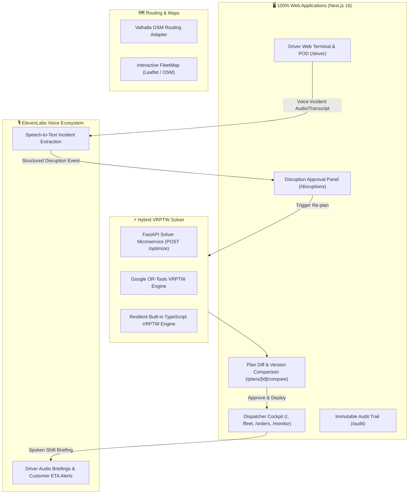

<div align="center">

# ⚡ DispatchX (VORTEXA 3.0 / ReRoute)
### Autonomous, Human-in-the-Loop Dynamic Logistics Dispatch & Disruption Recovery

[](https://nextjs.org/)
[](https://fastapi.tiangolo.com/)
[](https://developers.google.com/optimization)
[](https://postgis.net/)
[](https://elevenlabs.io/)
[](https://valhalla.github.io/valhalla/)
[](https://github.com/safishamsi/graphify)

*High-precision, resilient fleet operations platform for real-time delivery management, automated disruption recovery, and human-in-the-loop dispatching.*

---

</div>

## 📌 Executive Summary

Modern urban logistics networks face constant disruptions: vehicle breakdowns, emergency road closures, last-minute order additions, and severe traffic congestion.

**DispatchX** delivers a complete, self-healing dispatch loop built as a **100% responsive web application** for both Dispatchers and Drivers:

1. **Excel & CSV Ingestion Engine:** Dispatchers upload daily delivery schedules (`.xlsx` or `.csv`) with strict validation (capacity bounds, time windows, coordinate fences, and automated formula injection sanitization `=,+,-,@`).
2. **Google OR-Tools VRPTW Solver:** Resolves multi-vehicle routing problems with hard constraints (vehicle weight and volume limits, driver shift boundaries, and delivery time windows) with resilient TypeScript local solver fallback.
3. **ElevenLabs Voice Incident Reporting:** Drivers report roadblocks or breakdowns verbally with hands-on-wheel via Web Speech/ElevenLabs. The system extracts disruption metadata (`type`, `severity`, `delay`, `location`) in real time.
4. **Human-in-the-Loop Re-optimization & Visual Diff:** Computes freeze horizons, preserves already delivered cargo, reassigns orphaned stops, and renders side-by-side plan diffs (`KEPT` green, `MOVED` blue, `BROKEN` orange) before activation.
5. **Atomic Concurrency Control:** Enforces optimistic version locking to prevent split-brain fleet updates.
6. **Driver Web Terminal & Proof of Delivery (POD):** Fully responsive web portal with touch signature signoff, photo attachment simulation, and audio shift briefings via ElevenLabs TTS.
7. **Immutable Audit Trail:** Cryptographically hashed timeline of all fleet updates and dispatches, exportable to JSON.

---

## 🏗️ System Architecture



---

## 🚀 Key Web Application Pages

| URL Route | Interface Name | Purpose & Capabilities |
|---|---|---|
| `/` | **Operations Dashboard** | Fleet status KPIs, active vehicles, disruption alert banners, quick action shortcuts |
| `/monitor` | **Live Telemetry & Fleet Map** | Interactive Leaflet map with vehicle markers, stop pins, route polylines, and road closures |
| `/fleet` | **Fleet & Drivers** | Vehicle capacity tracking (weight/volume), driver shift timers, status filters |
| `/orders` | **Orders & Cargo** | Order manifest, customer delivery addresses, time windows, weight/volume metrics |
| `/plans/new` | **Plan Ingestion** | Drag-and-drop Excel/CSV upload with validation rules and error diagnostic tables |
| `/plans/[id]/compare`| **Plan Version Comparison** | Side-by-side plan diff with `KEPT` (green), `MOVED` (blue), `BROKEN` (orange) categorization |
| `/disruptions` | **Disruptions & Approvals**| Active incidents, AI re-routing recommendations, and one-click dispatch approval |
| `/driver` | **Driver Web Portal** | Hands-free ElevenLabs voice incident reporting, turn-by-turn stop manifest, digital POD modal |
| `/audit` | **Immutable Audit Trail** | Cryptographically verified log of all dispatch actions, optimizations, and exports |

---

## 🛠️ Technology Stack

- **Frontend & Web Core:** Next.js 16 (App Router, Turbopack, React 19, TypeScript)
- **Styling & Design System:** Custom semantic tokens (Dark/Light mode support, WCAG AA contrast)
- **Maps & GIS:** Leaflet, OpenStreetMap tiles, Valhalla routing matrix adapter
- **Optimization:** Google OR-Tools (Python 3.12) & TypeScript heuristic VRPTW solver
- **Voice Intelligence:** ElevenLabs API (Voice ID integration, STT parsing, TTS synthesis)
- **Testing:** Vitest (20/20 unit/integration tests passing)
- **Context Engineering:** Graphify Knowledge Graph (774 nodes, 1,236 edges, 51 communities)

---

## 🏃 Getting Started

### Prerequisites
- Node.js 20+
- Python 3.11+
- Git

### Installation & Development Run
```bash
# Clone the repository
git clone https://github.com/shahebaz2210/Vortexa-3.0.git
cd Vortexa-3.0

# Install dependencies
npm install

# Run the Web Application
cd apps/web
npm run dev
```

Open [http://localhost:3000](http://localhost:3000) to access the Dispatcher Cockpit, or [http://localhost:3000/driver](http://localhost:3000/driver) for the Driver Portal.

### Running Test Suite
```bash
cd apps/web
npx vitest run
```

---

## 📄 License
MIT License. Built for the DispatchX / VORTEXA 3.0 Platform.
