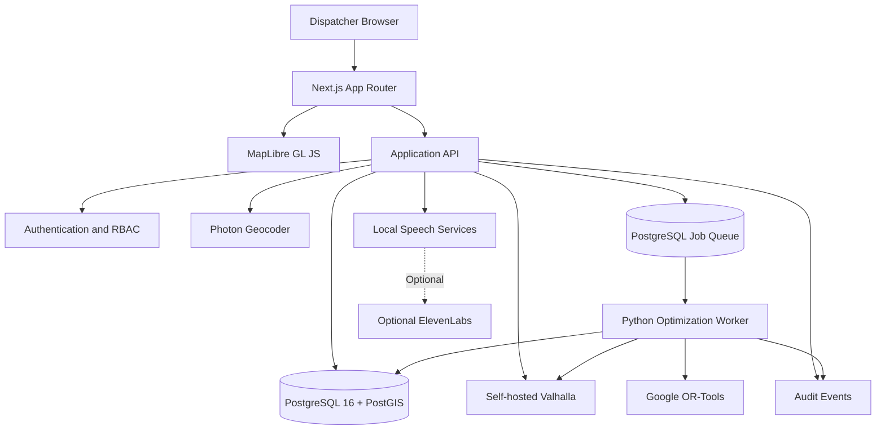
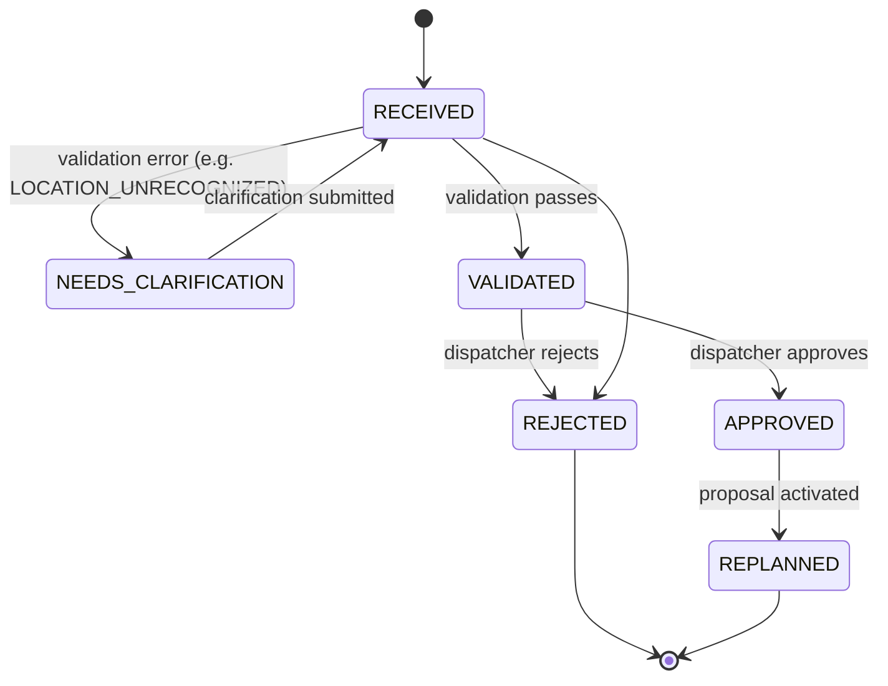
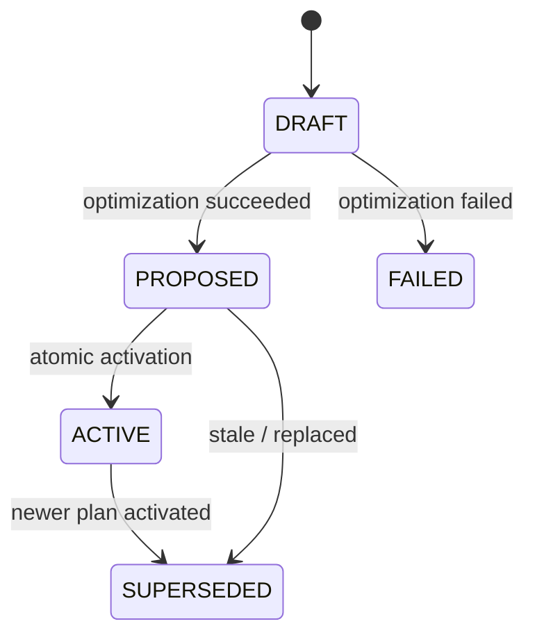
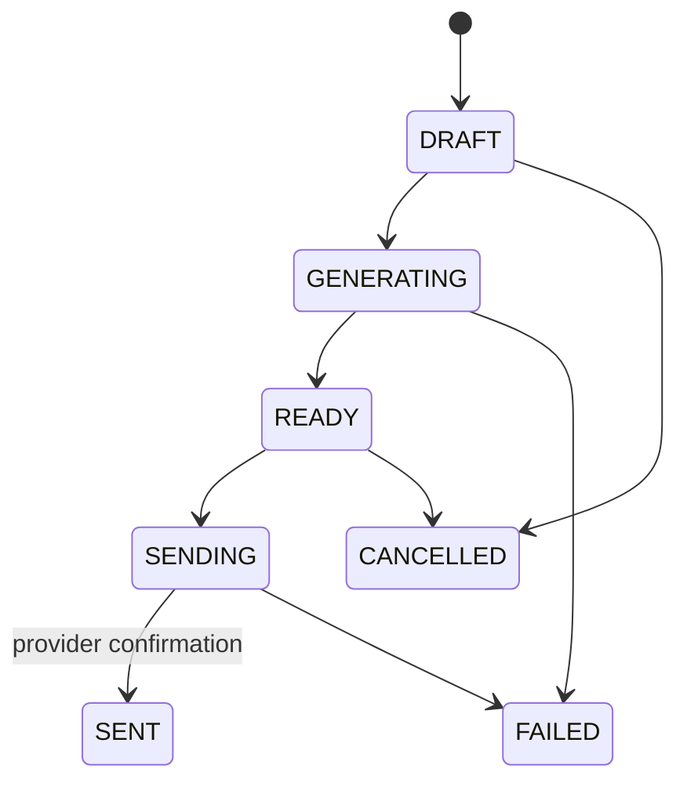

# VORTEXA / ReRoute — Technical Requirements Document (TRD)

| Field | Value |
|---|---|
| **Version** | 1.0 |
| **Date** | 11 October 2026 |
| **Status** | Draft for implementation |
| **Project** | VORTEXA / ReRoute — Intelligent Delivery Route Replanning System |
| **Architecture** | Open-source-first, modular monolith + separately deployable Python optimization worker |

---

## Table of Contents

1. [Purpose, Scope, and Principles](#1-purpose-scope-and-principles)
2. [System Architecture and Topology](#2-system-architecture-and-topology)
3. [Technology Stack](#3-technology-stack)
4. [Repository Structure](#4-repository-structure)
5. [Database Design](#5-database-design)
6. [Row-Level Security and Authorization](#6-row-level-security-and-authorization)
7. [Domain Models and State Machines](#7-domain-models-and-state-machines)
8. [Incident Validation Pipeline](#8-incident-validation-pipeline)
9. [Mapping, Routing, and Geocoding](#9-mapping-routing-and-geocoding)
10. [Route Optimization Engine](#10-route-optimization-engine)
11. [Route Comparison and Proposals](#11-route-comparison-and-proposals)
12. [API and Mutation Contracts](#12-api-and-mutation-contracts)
13. [Atomic Route Activation](#13-atomic-route-activation)
14. [Environment Configuration](#14-environment-configuration)
15. [Frontend and State Management](#15-frontend-and-state-management)
16. [Voice and Customer Notifications](#16-voice-and-customer-notifications)
17. [Security Requirements](#17-security-requirements)
18. [Failure Handling](#18-failure-handling)
19. [Observability and SLOs](#19-observability-and-slos)
20. [Testing and Acceptance Criteria](#20-testing-and-acceptance-criteria)
21. [Docker and Deployment](#21-docker-and-deployment)
22. [CI/CD Requirements](#22-cicd-requirements)
23. [Traceability Matrix](#23-traceability-matrix)
24. [Implementation Phases](#24-implementation-phases)
25. [Final Delivery Requirements](#25-final-delivery-requirements)
26. [Open Decisions, Risks, and Dependencies](#26-open-decisions-risks-and-dependencies)
27. [Final Engineering Principle](#27-final-engineering-principle)

---

## 1. Purpose, Scope, and Principles

### 1.1 Objective

Build a production-ready delivery route planning and incident-driven route replanning application using open-source mapping, routing, geographic data, and optimization technologies wherever practical.

The system supports:

- Fleet management and delivery scheduling
- Incident reporting (vehicle breakdowns, road closures, traffic delays, urgent orders)
- Route optimization and before/after comparison
- Dispatcher approval of route changes
- Customer voice updates and fleet audio briefings

### 1.2 Guiding principles

1. **Operational correctness** over feature breadth.
2. **Human approval** is required for incident acceptance and route activation.
3. **Explainable outcomes** — every unassigned (BROKEN) delivery has a reason code and explanation.
4. **Tenant isolation** enforced in the database (RLS), not only in application code.
5. **Reproducible engineering** — pinned dependencies, lockfiles, migrations, benchmarks.
6. **No unverified claims** — nothing is reported as running, passed, sent, activated, or achieved unless verified.

### 1.3 Non-goals

- A generic "AI control tower".
- Autonomous (unapproved) route activation.
- Reliance on mandatory proprietary mapping or optimization subscriptions.
- Silent substitution of straight-line distance for road travel time.

---

## 2. System Architecture and Topology

### 2.1 Architecture decisions

| ID | Decision |
|---|---|
| ARC-1 | Core web application is a **modular monolith**; the optimization worker is a separately deployable Python service. |
| ARC-2 | The web application owns authentication, authorization, business rules, approvals, DB transactions, and audit history. |
| ARC-3 | The optimization worker owns computationally intensive optimization. It **never activates** route plans. |
| ARC-4 | **Valhalla** owns road-network routing and travel-time/distance matrices. |
| ARC-5 | **OR-Tools** owns constrained vehicle-routing optimization. |
| ARC-6 | **PostgreSQL/PostGIS** is the source of truth for vehicles, orders, incidents, plans, proposals, and audit events. |
| ARC-7 | All components are deployable without a mandatory proprietary subscription. |

### 2.2 Architecture diagram



The diagram must be kept in valid Mermaid syntax and updated whenever topology changes.

### 2.3 Application modules

| Module | Responsibility |
|---|---|
| `fleet` | Vehicles, capacity, availability, current positions |
| `orders` | Customers, orders, delivery windows, package weights, delivery status |
| `locations` | Verified geographic locations, location-code validation |
| `incidents` | Intake, validation, approval, rejection |
| `routing` | Valhalla integration, travel matrices, route geometry |
| `optimization` | Job scheduling, solver inputs, feasibility checks, proposals |
| `route-plans` | Versioned plans and activation |
| `route-diff` | KEPT / MOVED / BROKEN comparison |
| `voice` | Speech-to-text and text-to-speech adapters |
| `notifications` | Customer message generation, previews, delivery status |
| `audit` | Immutable operational history |
| `fleet-briefings` | Route summaries and optional audio |

**Requirements**

- ARC-8: Modules communicate through typed service interfaces.
- ARC-9: Authorization and transaction boundaries are enforced server-side.

---

## 3. Technology Stack

| Component | Technology |
|---|---|
| Language | TypeScript 5.x, strict mode |
| Web framework | Next.js 15 App Router |
| UI | React 19 |
| Styling | Tailwind CSS v4 |
| Map rendering | MapLibre GL JS |
| Geographic data | OpenStreetMap |
| Routing engine | Self-hosted Valhalla |
| Geocoding | Self-hosted Photon |
| Backend optimization | Python 3.12 |
| Worker API | FastAPI + Pydantic |
| Optimization solver | Google OR-Tools |
| Database | PostgreSQL 16 + PostGIS |
| ORM | Drizzle ORM |
| Schema validation | Zod |
| Server-state | TanStack Query v5 |
| Client-state | Zustand |
| Authentication | Secure server-managed auth, or Supabase Auth |
| Background jobs | PostgreSQL-backed queue |
| Object storage | MinIO or compatible private object store |
| Speech recognition | Approved locally hosted STT model |
| Speech synthesis | Approved locally hosted TTS engine |
| Testing | Vitest, Playwright, pytest |
| Dev infrastructure | Docker Compose |
| Production infrastructure | Containerized app, worker, routing, and database services |

**Requirements**

- STK-1: Pin compatible dependency versions and commit all lockfiles.
- STK-2: Do not mix framework versions or add dependencies without compatibility checks.
- STK-3: Retain required OpenStreetMap attribution and comply with ODbL obligations.
- STK-4: Review licenses for geographic extracts, voice models, speech engines, container images, and all dependencies before deployment.
- STK-5: Public demo endpoints (tiles, geocoders, routing) must not be treated as production infrastructure.

---

## 4. Repository Structure

```text
reroute/
├── apps/
│   └── web/
│       ├── app/
│       ├── components/
│       ├── features/
│       ├── lib/
│       └── tests/
├── services/
│   └── optimizer/
│       ├── app/
│       │   ├── api/
│       │   ├── domain/
│       │   ├── routing/
│       │   └── solver/
│       ├── tests/
│       └── pyproject.toml
├── packages/
│   ├── contracts/        # shared typed contracts (Zod / Pydantic-aligned)
│   └── database/         # Drizzle schema and config
├── infra/
│   ├── docker/
│   └── migrations/
└── docker-compose.yml
```

- REPO-1: Deliver working source files, configuration, migrations, tests, and scripts. Empty placeholder directories do not count as an implementation.

---

## 5. Database Design

### 5.1 Conventions

| ID | Convention |
|---|---|
| DB-1 | UUIDv7 primary keys generated by a **verified application-side implementation** (PostgreSQL 16 has no built-in UUIDv7). |
| DB-2 | Timestamps are `timestamptz`. |
| DB-3 | Geographic coordinates use SRID 4326 (PostGIS). |
| DB-4 | Units: distance in **metres**, weight in **kilograms**, duration in **seconds**. |
| DB-5 | All operational entities are tenant-scoped. |
| DB-6 | Explicit foreign keys, unique constraints, indexes, and CHECK constraints. |
| DB-7 | Completed delivery events are preserved. |
| DB-8 | Route plans and optimization proposals are versioned. |
| DB-9 | A browser-provided tenant ID is never the authority for DB access. |

### 5.2 Required tables

| # | Table | Notes |
|---|---|---|
| 1 | `organizations` | Tenants |
| 2 | `memberships` | User ↔ organization ↔ role |
| 3 | `locations` | Verified catalog; PostGIS point; location code |
| 4 | `vehicles` | Capacity (kg), status, last position, position timestamp |
| 5 | `customers` | Includes notification consent |
| 6 | `orders` | Time windows, service duration, weight, priority, status |
| 7 | `route_plans` | Versioned; status; approver and activation timestamps |
| 8 | `route_stops` | Per-plan stop sequence, planned arrival |
| 9 | `delivery_events` | Append-only delivery history |
| 10 | `incidents` | Type, status, extracted fields, validation errors |
| 11 | `optimization_jobs` | Status, solver status, latency, input snapshot reference |
| 12 | `plan_diffs` | KEPT/MOVED/BROKEN rows with old/new vehicle and arrival, reasons |
| 13 | `customer_notifications` | Lifecycle state, provider results, idempotency |
| 14 | `fleet_briefings` | Text, optional audio reference, source plan |
| 15 | `audit_events` | Append-only |
| 16 | `idempotency_records` | Key, request hash, stored response |

### 5.3 Required enums

- Member roles
- Vehicle statuses
- Delivery statuses
- Incident types
- Incident statuses
- Route-plan statuses
- Optimization-job statuses
- Delivery comparison classifications
- Notification statuses

### 5.4 Schema capability requirements

The schema must support: vehicle capacities, vehicle positions and position timestamps, customer notification consent, delivery time windows, service durations, incident validation errors, proposal versioning, solver status, optimization latency, assignment changes, and notification provider results.

### 5.5 SQL deliverables

Provide complete, executable PostgreSQL migration files containing:

- Extension initialization (e.g., PostGIS)
- Enum definitions
- All `CREATE TABLE` statements
- UUID primary keys
- Foreign-key, unique, and CHECK constraints
- Geographic (GiST) indexes and operational query indexes
- **Tenant-scoped composite foreign keys**
- Row-Level Security policies
- Supporting functions
- Immutability and state-transition enforcement (triggers/constraints)
- Database grants/permissions
- Migration ordering and rollback guidance

No pseudo-SQL; essential constraints must not exist only as comments.

---

## 6. Row-Level Security and Authorization

### 6.1 Requirements

- RLS-1: `ENABLE` **and** `FORCE` RLS on all protected tenant-scoped tables.
- RLS-2: Explicit `SELECT`, `INSERT`, `UPDATE`, and `DELETE` policies per entity.
- RLS-3: Application uses a **non-owner** DB role without `BYPASSRLS`; it is not a superuser.
- RLS-4: Migration credentials are separate from application credentials.
- RLS-5: Tenant and user context are set **transaction-locally** (e.g., `SET LOCAL` / `set_config(..., true)`) after authentication, never from raw browser values.
- RLS-6: RLS is tested using real runtime roles, including UUID-guessing attempts.

### 6.2 Role capabilities

| Role | Capability |
|---|---|
| `ADMIN` | Manage authorized tenant resources |
| `DISPATCHER` | Manage operational data; approve incidents and route changes; activate plans |
| `DRIVER` | Access only permitted vehicle and delivery resources |
| `VIEWER` | Read-only access to authorized data |

### 6.3 Invariants

- No user can access another tenant's resources.
- `audit_events` and `delivery_events` are append-only for normal runtime operations (no UPDATE/DELETE grants or policies; reinforced by triggers).
- Completed deliveries cannot be deleted or silently reassigned.
- Route activation requires explicit authorization (DISPATCHER/ADMIN).

---

## 7. Domain Models and State Machines

Shared typed contracts are maintained in `packages/contracts` and mirrored in Pydantic models for the worker.

### 7.1 Enumerations

| Domain | Values |
|---|---|
| Incident type | `VEHICLE_BREAKDOWN`, `ROAD_CLOSURE`, `TRAFFIC_DELAY`, `URGENT_ORDER`, `OTHER` |
| Incident status | `RECEIVED`, `NEEDS_CLARIFICATION`, `VALIDATED`, `APPROVED`, `REJECTED`, `REPLANNED` |
| Optimization status | `QUEUED`, `RUNNING`, `SUCCEEDED`, `FAILED`, `CANCELLED` |
| Plan status | `DRAFT`, `PROPOSED`, `ACTIVE`, `SUPERSEDED`, `FAILED` |
| Comparison class | `KEPT`, `MOVED`, `BROKEN` |
| Notification status | `DRAFT`, `GENERATING`, `READY`, `SENDING`, `SENT`, `FAILED`, `CANCELLED` |

### 7.2 Incident state machine



### 7.3 Route plan state machine



### 7.4 Notification lifecycle



### 7.5 State rules

- ST-1: A finalized proposal is **immutable**; changes require a new proposal version.
- ST-2: A failed optimization must **never** partially activate a plan.
- ST-3: A stale proposal must **never** overwrite a newer active plan.
- ST-4: Invalid transitions return `INVALID_STATE_TRANSITION` and are additionally blocked at the DB layer.

---

## 8. Incident Validation Pipeline

### 8.1 Pipeline

1. Receive text or recorded audio.
2. Transcribe audio when applicable.
3. Parse the report into structured fields.
4. Resolve the reported vehicle against the tenant's fleet.
5. Resolve locations against the verified location catalog.
6. Validate incident type, time, affected route segment, and delay values.
7. Persist the incident and validation results.
8. Display extracted fields and validation errors.
9. Require **explicit dispatcher approval**.
10. Create an optimization job **only after successful approval**.

### 8.2 Rules

- INC-1: Unknown location code → return `LOCATION_UNRECOGNIZED` and request clarification (status `NEEDS_CLARIFICATION`).
- INC-2: Never silently choose the nearest location.
- INC-3: AI-generated coordinates are never authoritative.
- INC-4: AI extraction may assist interpretation, but all operationally important values are validated against authoritative records.
- INC-5: Speech-provider failure must never approve an incident.

---

## 9. Mapping, Routing, and Geocoding

### 9.1 MapLibre GL JS

Display on the dispatcher map:

- Vehicle positions and availability
- Current (active) and proposed routes
- Delivery stops
- Incident locations and affected road segments (where known)
- Route-comparison highlights
- Unassigned deliveries

Visual distinction is required between: **active routes, proposed routes, completed stops, moved stops, and unassigned deliveries**.

- MAP-1: Map rendering must not determine business rules or authorization.

### 9.2 OpenStreetMap

- OSM-1: Visible attribution at all times on the map.
- OSM-2: Select an appropriate geographic extract and document it.
- OSM-3: Document the data update process.
- OSM-4: Respect licensing (ODbL).
- OSM-5: Use a self-hosted or properly licensed tile provider; do not rely on public tile servers in production.

### 9.3 Valhalla

Used for road-network routing, route geometry, and travel-time / travel-distance matrices.

- VAL-1: The worker builds travel costs from **current validated vehicle positions** and remaining delivery locations.
- VAL-2: Validate matrix ordering, missing results, unreachable pairs, and routing errors.
- VAL-3: **Never** silently replace road travel time with straight-line distance.
- VAL-4: If a closure cannot be represented in Valhalla, use an explicitly validated restriction mechanism or mark affected paths infeasible in the optimization layer.

### 9.4 Photon

- GEO-1: Optional address search/geocoding.
- GEO-2: Geocoding results must be validated before becoming authoritative delivery locations.
- GEO-3: Prefer existing verified location records over newly inferred coordinates.

---

## 10. Route Optimization Engine

### 10.1 Implementation

Python 3.12, FastAPI, Pydantic, Google OR-Tools. The worker receives an **immutable, versioned input snapshot** containing:

- Source plan ID and version
- Remaining incomplete deliveries
- Vehicle availability and latest validated positions
- Remaining vehicle capacity
- Delivery time windows, service durations, priority levels
- Validated incidents
- Travel-time and distance matrices
- Configured optimization weights
- Solver time budget

The worker must not directly activate route plans.

### 10.2 Hard constraints

| ID | Constraint |
|---|---|
| OPT-H1 | Completed deliveries remain fixed. |
| OPT-H2 | Broken vehicles receive no new assignments. |
| OPT-H3 | Vehicle load never exceeds capacity. |
| OPT-H4 | Time windows are respected unless an explicitly authorized exception is recorded. |
| OPT-H5 | Unreachable destinations cannot be silently assigned. |
| OPT-H6 | Every remaining delivery is assigned feasibly or reported as unassigned. |
| OPT-H7 | Invalid or stale snapshots cannot produce activatable proposals. |

### 10.3 Objective function

```
minimize:
    w_t × total_travel_time
  + w_d × total_delivery_delay
  + w_r × number_of_reassignments
  + w_u × number_of_unassigned_deliveries
```

- OPT-O1: Weights are configurable and documented.
- OPT-O2: `w_u` is high enough to discourage avoidable unassignment but never overrides hard feasibility constraints.

### 10.4 Performance

- **Target:** usable proposal in **< 2 seconds** for the defined benchmark fleet (a target, not a verified claim).
- Measure separately: matrix generation, solver runtime, proposal persistence, total job duration.
- Report **p50, p95, p99** latency.
- Benchmark small, medium, and large fleet scenarios.
- On solver time limit: return a feasible incumbent when available, labeled `TIME_LIMIT`.
- Do not claim the target is met until benchmark results verify it.

---

## 11. Route Comparison and Proposals

Compare the active plan with the proposed plan for **every remaining delivery**.

| Class | Definition |
|---|---|
| `KEPT` | Vehicle assignment and schedule remain materially unchanged |
| `MOVED` | Vehicle assignment **or** planned arrival changes |
| `BROKEN` | No feasible assignment found |

### 11.1 BROKEN reason codes

`CAPACITY_EXCEEDED`, `NO_AVAILABLE_VEHICLE`, `TIME_WINDOW_INFEASIBLE`, `LOCATION_UNREACHABLE`, `ROAD_CLOSURE`, `OPTIMIZATION_LIMIT`, `OTHER`

Every BROKEN result includes a structured reason code **and** a human-readable explanation.

### 11.2 Persisted fields

Source plan version, proposal version, old/new vehicle IDs, old/new arrival times, and reasons for unassigned deliveries.

- DIFF-1: A materially rescheduled delivery is never classified `KEPT` merely because the vehicle is unchanged. The "material change" arrival-time threshold must be configured and documented.

---

## 12. API and Mutation Contracts

All endpoints are authenticated and tenant-scoped under `/api/v1` (health endpoints under `/api`).

| Endpoint | Method | Purpose | Roles (min.) |
|---|---|---|---|
| `/api/v1/fleet` | GET | List authorized vehicles | VIEWER+ |
| `/api/v1/fleet/:id/position` | PATCH | Update validated position | DISPATCHER, DRIVER (own vehicle) |
| `/api/v1/orders` | GET | List deliveries | VIEWER+ |
| `/api/v1/orders` | POST | Create delivery | DISPATCHER+ |
| `/api/v1/orders/:id` | PATCH | Update permitted fields | DISPATCHER+ |
| `/api/v1/routes/active` | GET | Read active plan | VIEWER+ |
| `/api/v1/incidents` | POST | Submit text incident | DISPATCHER+ |
| `/api/v1/incidents/voice` | POST | Submit voice incident | DISPATCHER+ |
| `/api/v1/incidents/:id/validate` | POST | Validate incident | DISPATCHER+ |
| `/api/v1/incidents/:id/approve` | POST | Approve incident | DISPATCHER+ |
| `/api/v1/incidents/:id/reject` | POST | Reject incident | DISPATCHER+ |
| `/api/v1/optimization-jobs` | POST | Enqueue optimization | DISPATCHER+ |
| `/api/v1/optimization-jobs/:id` | GET | Read job status | VIEWER+ |
| `/api/v1/proposals/:id/diff` | GET | Read comparison | VIEWER+ |
| `/api/v1/proposals/:id/activate` | POST | Activate approved proposal | DISPATCHER+ |
| `/api/v1/orders/:id/customer-audio` | POST | Generate customer audio | DISPATCHER+ |
| `/api/v1/notifications/:id/preview` | GET | Access authorized audio | DISPATCHER+ |
| `/api/v1/notifications/:id/send` | POST | Send authorized notification | DISPATCHER+ |
| `/api/v1/fleet-briefings` | POST | Generate fleet briefing | DISPATCHER+ |
| `/api/v1/audit-events` | GET | Read authorized audit history | ADMIN, DISPATCHER |
| `/api/health` | GET | Liveness | Public |
| `/api/ready` | GET | Dependency readiness | Internal |

> Minimum-role column is the proposed default; final role mapping is confirmed in the authorization design and enforced by RLS plus server guards.

### 12.1 Per-mutation specification

For **every** mutation the implementation must define and document:

1. Zod request schema (strict field allowlist)
2. Typed return shape
3. Authentication guard
4. Tenant authorization
5. Role authorization
6. DB transaction requirements
7. Idempotency behavior (via `Idempotency-Key` and `idempotency_records`)
8. Audit behavior
9. Error responses

### 12.2 Error envelope and codes

All errors use a consistent envelope including `code`, `message`, `requestId`, and optional `details`.

| Code | Suggested HTTP status |
|---|---|
| `INVALID_REQUEST` | 400 |
| `UNAUTHENTICATED` | 401 |
| `FORBIDDEN` | 403 |
| `NOT_FOUND` | 404 |
| `STALE_PLAN_VERSION` | 409 |
| `INVALID_STATE_TRANSITION` | 409 |
| `LOCATION_UNRECOGNIZED` | 422 |
| `INFEASIBLE_PLAN` | 422 |
| `RATE_LIMITED` | 429 |
| `ROUTING_PROVIDER_ERROR` | 502 |
| `OPTIMIZATION_UNAVAILABLE` | 503 |
| `OPERATION_TIMEOUT` | 504 |

---

## 13. Atomic Route Activation

Activation executes as **one database transaction**:

```mermaid
sequenceDiagram
    participant D as Dispatcher
    participant A as App API
    participant DB as PostgreSQL

    D->>A: POST /proposals/:id/activate (expectedSourceVersion)
    A->>A: Authenticate, verify tenant and role
    A->>DB: BEGIN; set tenant/user context (local)
    A->>DB: Lock active + proposed plans (FOR UPDATE)
    A->>DB: Verify expected source plan version
    A->>DB: Verify incident APPROVED
    A->>DB: Verify proposal still feasible
    A->>DB: Verify completed deliveries unchanged
    A->>DB: Old plan -> SUPERSEDED; proposal -> ACTIVE
    A->>DB: Record approver + activation timestamps
    A->>DB: Insert audit event
    A->>DB: COMMIT
    A-->>D: 200 Activated
```

- ACT-1: Any failed check rolls back the entire transaction.
- ACT-2: A stale proposal returns **HTTP 409** with `STALE_PLAN_VERSION`.
- ACT-3: Never silently rebase or activate stale proposals.
- ACT-4: A conflicting concurrent activation is rejected; the client refreshes the active plan.
- ACT-5: If the database is unavailable, never report success.

---

## 14. Environment Configuration

### 14.1 Server-side variables

| Variable | Required |
|---|---|
| `NODE_ENV` | Always |
| `APP_BASE_URL` | Always |
| `DATABASE_URL` | Always (runtime role) |
| `DATABASE_MIGRATION_URL` | Migration/CI only (separate credentials) |
| `AUTH_SECRET` | Always |
| `AUTH_ISSUER_URL` | Always |
| `AUTH_CLIENT_ID` | Always |
| `AUTH_CLIENT_SECRET` | If provider requires |
| `OPTIMIZER_BASE_URL` | Always |
| `OPTIMIZER_SHARED_SECRET` | Always |
| `VALHALLA_BASE_URL` | Always |
| `PHOTON_BASE_URL` | If Photon enabled |
| `AUDIO_STORAGE_ENDPOINT` / `_BUCKET` / `_ACCESS_KEY` / `_SECRET_KEY` | If audio storage enabled |
| `ELEVENLABS_API_KEY`, `ELEVENLABS_VOICE_ID` | If ElevenLabs enabled |
| `STT_MODEL_PATH`, `TTS_MODEL_PATH` | If local speech enabled |
| `LOG_LEVEL` | Always |
| `SENTRY_DSN` | If enabled |

### 14.2 Client-side variables

- `NEXT_PUBLIC_MAP_STYLE_URL`
- `NEXT_PUBLIC_APP_NAME`

### 14.3 Rules

- ENV-1: Never expose DB credentials, auth secrets, storage credentials, worker secrets, or speech-provider keys via `NEXT_PUBLIC_*`.
- ENV-2: Separate Zod schemas for server and client configuration.
- ENV-3: Application startup fails if required configuration is invalid.
- ENV-4: Optional groups (storage, voice) are validated **together** so partial configuration cannot cause runtime failures.
- ENV-5: Provide `.env.example` documenting every variable.

---

## 15. Frontend and State Management

- FE-1: Next.js App Router with React Server Components for server-rendered content.
- FE-2: Client Components for interactive maps, route comparison, voice recording, audio playback, modal/tab state, and forms.
- FE-3: TanStack Query v5 for client fetching, invalidation, polling, and mutation state.
- FE-4: Zustand only for **transient UI state**.
- FE-5: The server is authoritative for tenant membership, authorization, vehicle capacity, delivery status, incident approval, route feasibility, route activation, and notification delivery.

### Required views

1. Fleet overview
2. Interactive route map
3. Incident intake and verification
4. Incident approval and rejection
5. Optimization progress
6. Before/after route comparison
7. Unassigned delivery explanations
8. Customer voice preview
9. Fleet audio briefing
10. Audit history

---

## 16. Voice and Customer Notifications

### 16.1 Open-source-first speech

- VOX-1: Prefer approved local STT/TTS models.
- VOX-2: Typed provider adapters for STT and TTS so providers are swappable without business-logic changes.
- VOX-3: Text incident reporting works when speech services are unavailable.
- VOX-4: Verify model and engine licenses before deployment.

### 16.2 Optional ElevenLabs

If enabled: server-side credentials only; request timeouts; validated request/response payloads; validated audio content types and sizes; bounded retries; quota/failure monitoring; text fallback preserved. Provider failure must never approve incidents or activate routes.

### 16.3 Notification workflow

1. Generate message from verified proposal data.
2. Check customer eligibility and consent.
3. Generate audio.
4. Store audio privately.
5. Allow authorized preview.
6. Send via configured provider when enabled.
7. Record provider response and delivery status.

- NOT-1: Idempotency keys prevent duplicate calls/messages.
- NOT-2: Generating audio is **not** proof of contact; `SENT` requires provider confirmation.

### 16.4 Fleet briefings

Generated from persisted, approved optimization results; includes active vehicle count, assigned count, moved count, unassigned count, significant route changes, and known warnings. The briefing must match the persisted plan and never invent metrics.

---

## 17. Security Requirements

| ID | Requirement |
|---|---|
| SEC-1 | Secure server-managed sessions; HTTP-only cookies; `Secure` in production; appropriate `SameSite` |
| SEC-2 | CSRF protection for cookie-authenticated mutations |
| SEC-3 | Tenant-scoped authorization and PostgreSQL RLS |
| SEC-4 | Explicit request validation and strict field allowlists |
| SEC-5 | Rate limiting |
| SEC-6 | Private audio storage; short-lived signed URLs |
| SEC-7 | Secret management and rotation |
| SEC-8 | Structured audit logging; append-only history |
| SEC-9 | Dependency and container security scans |
| SEC-10 | Restricted internal networking (DB and worker not publicly exposed) |
| SEC-11 | Database backups with **tested** recovery |
| SEC-12 | Do not log secrets, tokens, raw audio, or unnecessary customer data |
| SEC-13 | Web ↔ worker calls authenticated with `OPTIMIZER_SHARED_SECRET` |
| SEC-14 | DB runtime role is not superuser, not an over-privileged owner, and lacks `BYPASSRLS` |

---

## 18. Failure Handling

| Failure | Required behavior |
|---|---|
| Valhalla unavailable | Fail/retry job per policy; never invent travel times |
| Optimizer unavailable | Preserve active route; permit retry; report job status |
| STT unavailable | Permit text incident reporting |
| TTS unavailable | Preserve verified text; allow manual communication |
| Stale proposal | `STALE_PLAN_VERSION` (409) |
| Conflicting activation | Reject second activation; refresh active plan |
| Unknown location | Request clarification |
| No feasible assignment | Preserve delivery; record unassigned reason |
| Database unavailable | Fail mutations safely; never claim activation succeeded |
| Notification provider unavailable | Keep pending state; record failure and retry status |

---

## 19. Observability and SLOs

### 19.1 Metrics

`optimization_job_duration_ms`, `optimization_solver_duration_ms`, `routing_matrix_duration_ms`, `optimization_job_failure_total`, `optimization_unassigned_deliveries_total`, `incident_validation_rejection_total`, `route_plan_activation_conflict_total`, `voice_transcription_duration_ms`, `voice_generation_duration_ms`, `customer_notification_failure_total`, `database_query_duration_ms`, `stale_vehicle_position_total`

### 19.2 Logging

Structured logs with request ID, job ID, plan version, tenant context where appropriate, and error code. No secrets or unnecessary personal data.

### 19.3 Proposed SLOs (targets, not measured claims)

- Optimization processing < 2 s for the defined benchmark fleet
- 99.5% monthly availability (initial)
- No silent stale-plan activation
- Zero completed-delivery preservation failures in acceptance tests
- Zero cross-tenant isolation failures in security tests
- Text workflows remain available during speech outages
- 100% of route activations and incident approvals audited

---

## 20. Testing and Acceptance Criteria

Tools: Vitest, Playwright, pytest, against a **real PostgreSQL/PostGIS** test database.

| # | Required test | Primary layer |
|---|---|---|
| 1 | Vehicle breakdown prevents new assignments to that vehicle | pytest |
| 2 | Completed deliveries remain fixed | pytest + DB |
| 3 | Road closures handled via validated routing restrictions | pytest |
| 4 | Urgent deliveries assigned feasibly or marked unassigned | pytest |
| 5 | Unknown locations require clarification | Vitest / API |
| 6 | Unapproved incidents cannot activate a route | API integration |
| 7 | Vehicle capacities never exceeded | pytest |
| 8 | BROKEN deliveries include reason codes and explanations | pytest + API |
| 9 | Stale proposals cannot overwrite newer active plans | API integration |
| 10 | Duplicate requests do not create duplicate optimization jobs | API integration |
| 11 | Duplicate notifications do not trigger duplicate calls | API integration |
| 12 | Speech failure preserves text workflows | Vitest / Playwright |
| 13 | Cross-tenant access attempts denied | RLS / API |
| 14 | Audit events record approvals and activation | API integration |
| 15 | Performance tests report p50/p95/p99, matrix, solver, total | pytest benchmark |
| 16 | Failed optimization does not change active plan | API integration |
| 17 | Generated audio does not mark notification SENT without provider confirmation | API integration |

Additional: RLS tests with runtime roles including UUID-guessing; migration up/down tests.

---

## 21. Docker and Deployment

### 21.1 Development (Docker Compose)

- Next.js application
- PostgreSQL 16 + PostGIS
- Python optimization worker
- Valhalla with a bounded geographic extract
- Optional: Photon, MinIO, local speech services

### 21.2 Production

Containerized web app; private PostgreSQL/PostGIS; private optimization worker; self-hosted routing; scheduled geographic data updates; private audio storage; monitoring and alerting; automated DB backups; secret rotation; migration procedures; deployment rollback; disaster recovery.

- DEP-1: Never expose the database or optimizer directly to the public internet.
- DEP-2: Size production hardware only after benchmarking with a suitable geographic extract.

---

## 22. CI/CD Requirements

Every pull request runs:

1. Formatting and linting
2. TypeScript type checking
3. Python static checks
4. Unit tests
5. Database migration tests
6. RLS tests
7. Tenant-isolation tests
8. API integration tests
9. Production build
10. Dependency and container security scans

- Use a separate staging environment with non-production data.
- Before production deploy, verify configuration, migration compatibility, DB privileges, and health checks.

---

## 23. Traceability Matrix

| Product requirement | Implementation | Acceptance test(s) |
|---|---|---|
| Morning route planning | orders, fleet, locations, optimization | #4, #7, #15 |
| Vehicle breakdown | incidents, vehicle availability, replanning | #1 |
| Road closure | verified incident location, routing restrictions | #3 |
| Urgent order | order intake, constrained optimization | #4 |
| No guessed locations | verified location catalog, validation errors | #5 |
| Dispatcher approval | incident approval, atomic activation | #6, #14 |
| Completed deliveries | immutable delivery history, fixed completed stops | #2 |
| Current vehicle positions | timestamped positions, remaining-route optimization | #1, #15 |
| Capacity | vehicle and order constraints | #7 |
| Before/after comparison | versioned plans, KEPT/MOVED/BROKEN | #8, #9 |
| Customer voice updates | notification records, TTS adapters | #11, #17 |
| Actual telephone calls | optional telephony provider + confirmed delivery status | #11, #17 |
| Fleet audio briefing | persisted plan summary, TTS adapter | #12 |
| Two-second optimization | reproducible benchmark suite, measured results | #15 |
| Tenant isolation | RLS, runtime roles | #13 |
| Failure safety | transactional activation, job states | #9, #16 |

---

## 24. Implementation Phases

| Phase | Scope | Exit criteria |
|---|---|---|
| **1 — Foundation** | Repo setup; TS/Python configs; PostgreSQL/PostGIS; migrations; authentication; RLS; seed data; CI checks | Migrations apply cleanly; RLS tests pass with runtime role; CI green |
| **2 — Fleet and Map** | Fleet/order management; verified location catalog; MapLibre; OSM attribution; Valhalla deployment; routing matrix adapter | Map renders with attribution; matrix adapter validated against Valhalla |
| **3 — Optimization** | FastAPI worker; OR-Tools model; capacity and time windows; versioned jobs; proposal persistence; KEPT/MOVED/BROKEN; benchmarking | Constraint tests pass; benchmark report produced |
| **4 — Approval Workflow** | Incident validation; dispatcher approval; atomic activation; optimistic concurrency; audit; idempotency | Stale/conflict/idempotency tests pass |
| **5 — Voice** | Local STT/TTS; customer audio previews; optional ElevenLabs; fleet briefings; optional telephony | Text fallback verified; no SENT without provider confirmation |
| **6 — Hardening** | Security testing; cross-tenant tests; load tests; observability; backup/restore tests; deployment automation; production readiness review | All acceptance tests green; restore drill completed |

---

## 25. Final Delivery Requirements

- Complete application source code
- Database migration files; Drizzle schema and migration configuration
- TypeScript and Python dependency manifests and lockfiles
- Zod request validators and typed API contracts
- FastAPI worker and OR-Tools implementation
- Valhalla integration and MapLibre interface
- Authentication and authorization; RLS policies
- Voice-processing adapters
- Environment variable schemas
- Docker Compose configuration
- Production deployment documentation
- Unit, integration, end-to-end, and security tests
- Performance benchmarks
- README with setup instructions
- Troubleshooting and operations guide

All deliverables must be concrete, runnable, and internally consistent. Pseudo-code must not substitute for critical implementations. If a requirement depends on an external provider, unavailable infrastructure, or an unresolved business decision, document the exact dependency and implement a safe, testable adapter boundary.

**Verification honesty rule:** do not claim a service is running, a call was placed, a route was activated, a test passed, or a performance target was achieved unless it has actually been verified.

---

## 26. Open Decisions, Risks, and Dependencies

| # | Item | Type | Notes |
|---|---|---|---|
| 1 | Geographic extract/region for dev, benchmark, production | Decision | Drives Valhalla/Photon resource sizing |
| 2 | Authentication provider (server-managed vs Supabase Auth) | Decision | Affects session, CSRF, and RLS context wiring |
| 3 | Local STT/TTS model and engine selection | Decision | License review required |
| 4 | Telephony provider for actual calls | Dependency | Out of scope until chosen; adapter boundary only |
| 5 | Tile provider (self-hosted vs licensed) | Decision | No public tile servers in production |
| 6 | Benchmark fleet definition (small/medium/large sizes) | Decision | Required before any 2 s claim |
| 7 | "Materially unchanged" arrival-time threshold for KEPT | Decision | Must be documented and configurable |
| 8 | Default optimization weights (`w_t`, `w_d`, `w_r`, `w_u`) | Decision | Needs tuning against benchmarks |
| 9 | Road-closure representation in Valhalla | Risk | Fall back to infeasible-arc marking in solver |
| 10 | Meeting 2 s target on large fleets with live matrix generation | Risk | Measure matrix and solver separately; may need caching or limits |
| 11 | Valhalla / OR-Tools / Photon resource requirements | Risk | Size after benchmarking |

---

## 27. Final Engineering Principle

Build VORTEXA / ReRoute as a safe, explainable, open-source-first delivery route-replanning system. Preserve completed deliveries, validate locations, respect capacity and time windows, require dispatcher approval, prevent stale-plan activation, and explain every unassigned delivery. Prioritize operational correctness and reproducibility over unnecessary complexity or unverified AI automation.
